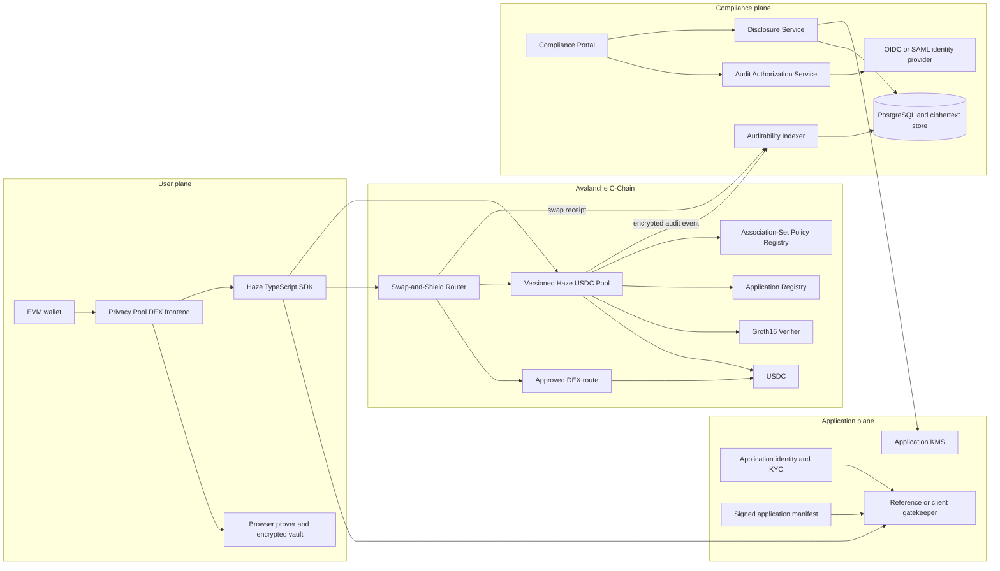

# Haze Avalanche Compliant Pool Design

## Architecture Overview

Haze is a new product boundary inside the repository. The Avalanche implementation may adapt reviewed
cryptographic primitives from the Stellar implementation, but it receives its own EVM contracts,
network adapter, service APIs, SDK, data model, and product frontends. No Soroban or SEP assumption is
allowed to leak into a Haze public interface.

The MVP is a shared USDC shielded pool. Registered applications authorize users and transactions;
Haze governance supplies a protocol-level policy root. The user frontend supports direct USDC
shielding and public swap-and-shield from configured Avalanche tokens. The Compliance Portal serves
application administrators, auditors, and Haze governance as role-separated workspaces.



### Technology stack

- **Contracts:** Solidity and Foundry, with narrowly selected audited OpenZeppelin primitives for
  signatures, token handling, access control, pausing, and reentrancy protection.
- **Circuits:** Circom and Groth16 over BN254. The first transaction circuit is fixed at two inputs
  and two outputs. Browser artifacts are built as versioned WASM/proving-key bundles.
- **Client:** TypeScript SDK using an EVM transport abstraction, a browser Web Worker prover, and a
  domain-separated encrypted local note vault.
- **Frontends:** separate Next.js deployments for the Privacy Pool DEX and Compliance Portal. The
  portal uses server-enforced roles in addition to route guards.
- **Services:** Rust services using a typed HTTP framework, an EVM client, PostgreSQL, and explicit
  adapters for OIDC/SAML and application KMS providers.
- **Storage:** PostgreSQL for normalized application, case, authorization, event, and access-log
  records; ciphertext may move to object storage behind the same repository interface at scale.

## Data Models

### Shielded note

The circuit treats a note as private data with these logical fields:

```text
Note {
  value: u64,
  owner_note_public_key: Field,
  owner_encryption_key_hash: Field,
  application_id: bytes32,
  blinding: Field
}
```

The note commitment is a domain-separated Poseidon hash of all fields. `application_id` prevents
cross-application spends. The encryption-key hash binds recipient delivery to the note without
publishing a wallet-to-shielded-key mapping. Amount arithmetic is range-constrained and
balance-conserving.

The nullifier is a domain-separated hash of the note secret, leaf position, application ID, and pool
version. The pool stores spent nullifiers globally for that version.

### Transaction public inputs

```text
TransactionPublicInputs {
  pool_version: bytes32,
  application_id: bytes32,
  merkle_root: Field,
  application_policy_version: uint64,
  haze_policy_version: uint64,
  application_membership_root: Field,
  haze_blocklist_root: Field,
  input_nullifiers: Field[2],
  output_commitments: Field[2],
  public_value: int64,
  public_recipient: address,
  intent_hash: bytes32,
  recipient_ciphertext_hashes: bytes32[2],
  audit_data_commitment: Field,
  audit_ciphertext_hash: bytes32
}
```

`public_value` is positive for a deposit, negative for a withdrawal, and zero for a private transfer.
The contract recomputes `intent_hash` from the action's public parameters and refuses proofs that are
not bound to the submitted EIP-712 authorization, recipient ciphertexts, canonical audit-data
commitment, and audit ciphertext.

### Gatekeeper authorization

```text
ApplicationAuthorization {
  application_id: bytes32,
  user: address,
  pool: address,
  pool_version: bytes32,
  action: DEPOSIT | TRANSFER | WITHDRAW | SWAP_AND_SHIELD,
  intent_hash: bytes32,
  application_policy_version: uint64,
  haze_policy_version: uint64,
  audit_data_commitment: Field,
  audit_ciphertext_hash: bytes32,
  nonce: bytes32,
  valid_after: uint48,
  valid_until: uint48
}
```

The application gatekeeper signs the typed value. The pool verifies the active gatekeeper key from
the registry and consumes the nonce. A signature is invalid across applications, pools, versions,
actions, users, policy versions, or time windows.

### Application and manifest

```text
ApplicationRecord {
  application_id: bytes32,
  admin: address,
  gatekeeper_signer: address,
  policy_authority: address,
  membership_root: Field,
  membership_version: uint64,
  audit_public_key: bytes,
  audit_key_version: uint64,
  manifest_uri: string,
  manifest_hash: bytes32,
  policy_profile: bytes32,
  status: PENDING | ACTIVE | SUSPENDED | RETIRED
}
```

The signed manifest carries organization metadata, gatekeeper and portal endpoints, auditor-policy
metadata, KMS key references, current and historical audit-key metadata, supported source-token
policy, and a manifest version. Secrets and PII are prohibited. The registry stores only its URI and
content hash. The application policy authority updates its KYC-backed membership root without Haze
governance becoming the KYC authority.

### Association-set policy

```text
PolicyVersion {
  version: uint64,
  global_blocklist_root: Field,
  activate_at: uint48,
  artifact_hash: bytes32,
  status: SCHEDULED | ACTIVE | RETIRED
}
```

Policy leaves use canonical domain-separated subject hashes:

```text
ApplicationMembershipSubject = H(
  "haze/app-member/v1",
  application_id,
  note_public_key,
  encryption_public_key_hash
)

HazeBlocklistSubject = H(
  "haze/global-block/v1",
  subject_kind,        // NOTE_KEY or EVM_ADDRESS
  chain_id,
  application_id_or_zero,
  subject_identifier
)
```

New global blocklist roots are scheduled by the Haze multisig through a timelock. The pool accepts
only the application membership root and Haze blocklist root active at execution; there is no
post-activation grace period. A scoped pause is available while an urgent scheduled Haze root waits
for timelock activation.

Normal transaction circuits prove that every nonzero input and output note key is a member of the
active application eligibility tree and absent from the active Haze global blocklist tree. Dummy
zero-value slots use an explicitly constrained enable bit. Applications map app-scoped note keys to
their private KYC subject records and prevent blocked identities from re-registering under fresh keys.
Deposits and withdrawals also check the relevant public EVM payer/recipient subject. Emergency exits
check both the spent note key and public recipient against the active Haze root. Haze does not claim
to maintain a global identity database.

### App-scoped Haze address and recipient ciphertext

```text
HazeAddress {
  version: uint8,
  application_id: bytes32,
  note_public_key: Field,
  x25519_encryption_public_key: bytes32,
  checksum: bytes4
}

RecipientNoteCiphertext {
  ephemeral_public_key: bytes32,
  nonce: bytes24,
  ciphertext_and_tag: bytes
}
```

The authenticated recipient plaintext contains note value, blinding, application/pool version, and
the encryption-key hash needed to recompute the output commitment. Recipients scan output events,
attempt X25519-based authenticated decryption, and accept a note only when its recomputed commitment
matches the emitted commitment. Recipient delivery does not use the application audit key and does
not require a public EVM-wallet-to-Haze-address registry.

### Audit record and access grant

```text
AuditRecord {
  chain_id: uint64,
  pool_version: bytes32,
  transaction_hash: bytes32,
  log_index: uint32,
  application_id: bytes32,
  action: enum,
  ciphertext: bytes,
  ciphertext_hash: bytes32,
  audit_data_commitment: Field,
  wrapped_data_key: bytes,
  audit_key_version: uint64,
  application_policy_version: uint64,
  haze_policy_version: uint64,
  block_number: uint64,
  finality_status: OBSERVED | FINALIZED | REORGED
}

DisclosureGrant {
  subject_id: string,
  organization_id: string,
  wallet: address,
  role: APP_ADMIN | APP_AUDITOR | HAZE_SUPER_AUDITOR,
  application_ids: bytes32[],
  case_id: uuid?,
  fields: string[],
  starts_at: timestamp,
  expires_at: timestamp
}

InvestigationCase {
  case_id: uuid,
  application_ids: bytes32[],
  purpose: string,
  status: DRAFT | ACTIVE | SUSPENDED | CLOSED,
  approved_fields: string[],
  starts_at: timestamp,
  expires_at: timestamp,
  approved_by: string[],
  policy_version: string
}

DisclosureAccessLog {
  request_id: uuid,
  subject_id: string,
  application_id: bytes32,
  case_id: uuid?,
  requested_fields: string[],
  decision: ALLOW | DENY,
  reason_code: string,
  occurred_at: timestamp,
  previous_hash: bytes32,
  record_hash: bytes32
}
```

Plaintext audit data includes only the transaction identifiers, initiator, counterparties, asset,
amount, timestamps, authorization reference, and policy version needed by the approved application
policy. Database rows remain application-partitioned even though the pool is shared. Access-log
records are hash-chained and copied to write-once retention storage so database administrators cannot
silently rewrite disclosure history.

For normal actions, the gatekeeper generates a fresh hidden audit salt, constructs the canonical audit
plaintext, computes `audit_data_commitment` over the transaction fields and salt, envelope-encrypts
the record to the application's versioned audit public key, and signs both commitment and ciphertext
hash. The circuit independently recomputes the commitment from the transaction witness and supplied
hidden salt. Emergency exits use the same canonical schema and circuit/contract binding but construct
the envelope client-side because no gatekeeper participates; all exit amount/recipient fields are
publicly cross-checked by the contract. After decryption, the disclosure service recomputes the
commitment and ciphertext hash before releasing any fields.

### Swap intent

```text
SwapIntent {
  application_id: bytes32,
  user: address,
  token_in: address,
  amount_in: uint256,
  min_usdc_out: uint256,
  route_hash: bytes32,
  recipient_commitment: Field,
  recipient_ciphertext_hash: bytes32,
  deadline: uint48,
  audit_data_commitment: Field,
  audit_ciphertext_hash: bytes32
}
```

Only allowlisted source tokens and adapter contracts are accepted. The route is public. The router
must complete the swap and USDC deposit atomically, refunding through transaction reversion rather
than retaining partial balances.

## API Design

### Application gatekeeper

- `POST /v1/authorizations` accepts an authenticated application session, transaction intent,
  selected input/output summary, recipient Haze address and ciphertext hash, and expected public
  inputs. After KYC, recipient, application policy, source token, amount limit, nonce, and expiry
  checks, the gatekeeper creates the canonical audit record and returns its hidden audit salt,
  envelope ciphertext, audit-data commitment, typed authorization, and signature.
- `GET /v1/applications/{applicationId}/manifest` returns the signed manifest and content hash.
- Responses use stable machine-readable error codes such as `USER_INELIGIBLE`, `POLICY_STALE`,
  `TOKEN_NOT_ALLOWED`, `LIMIT_EXCEEDED`, and `AUTHORIZATION_EXPIRED`.

The reference gatekeeper is open source and deployable by an application. Haze contracts trust only
the gatekeeper signer registered for that application, not the Haze-hosted reference endpoint.

### Swap quote adapter

- `POST /v1/swaps/quote` returns normalized quote data, the approved adapter, calldata hash,
  expected USDC output, minimum output, gas estimate, and expiry.
- Quotes are advisory until signed by the wallet. The on-chain router independently enforces token,
  adapter, minimum-output, recipient-commitment, and deadline constraints.
- Provider-specific quote and calldata formats terminate at an adapter boundary and never enter
  the Haze SDK public model.

### Policy witnesses

- `POST /v1/policy/application-witnesses` is an authenticated gatekeeper endpoint that returns active
  application-membership witnesses for approved input/output Haze addresses.
- `GET /v1/policy/haze-witness` is a public Haze policy endpoint that returns a non-membership witness
  for a canonical note-key or EVM-address subject under the active Haze root.
- Root/update events contain enough canonical data for an independent policy mirror to reconstruct
  and verify witnesses. Clients verify every returned witness locally before proving.
- Emergency exit depends only on public Haze witness availability; clients may use Haze's endpoint,
  an independent mirror, or local reconstruction from policy events.

### Audit authorization and disclosure

- `POST /v1/auth/challenge` creates a one-time SIWE challenge after institutional identity login.
- `POST /v1/auth/token` verifies the SIWE response and returns a short-lived, audience-bound token.
- `POST /v1/cases` and `PATCH /v1/cases/{caseId}` manage investigation purpose, approvals, scope,
  status, and expiry.
- `POST /v1/disclosures/query` returns only fields allowed by the token and case grant.
- `POST /v1/disclosures/export` creates a signed, expiring export with scope and provenance metadata.
- `GET /v1/access-log` exposes authorized access-log views without revealing other applications.

Authorization is enforced in the service/query layer, not only in the portal. The disclosure service
revalidates the token, case state, application scope, requested fields, KMS key reference, and record
finality before attempting decryption. It also recomputes the audit-data commitment and ciphertext
hash after decryption; a mismatch is an integrity failure, not a partially successful disclosure.
A Haze super-auditor grant does not bypass application KMS policy: each included application must
configure its KMS key policy for that approved case, or disclosure fails closed and records the denial.

### Contract interfaces

The stable contract surface contains:

- `deposit` for direct USDC shielding.
- `transact` for same-application private transfers and normal withdrawals.
- `swapAndShield` on the router for an atomic public swap followed by pool deposit.
- `requestEmergencyExit` and `executeEmergencyExit` for the seven-day fallback.
- registry methods for scheduled application, signer, policy-root, version, and status changes.

Direct `deposit` and `transact` calls require `msg.sender` to equal the authorized user. The pool has
a separate narrowly scoped `depositFromRouter` entry point callable only by an approved
SwapAndShieldRouter; it receives the original payer, verifies that payer against the same signed
intent, and accepts only the exact USDC amount produced by the route. The MVP has no generic trusted
forwarder or relayer path.

Events include application and policy identifiers, commitments/nullifiers as appropriate, and the
recipient note ciphertexts/hashes plus the encrypted audit payload, audit-data commitment, and hash.
Events never include plaintext private-note data.

## Component Breakdown

### Privacy Pool DEX frontend

- Connects an EVM wallet, selects the registered application, and establishes an application session.
- Derives the app- and pool-domain-separated shielded key locally; stores note state in an encrypted
  vault and can reconstruct it from chain events.
- Encodes and validates app-scoped Haze addresses, scans recipient ciphertexts, and accepts decrypted
  notes only after recomputing the emitted commitment.
- Offers direct shield, swap-and-shield, private send, withdraw, history, and emergency-exit views.
- Presents quote route, slippage, gas, public/private boundary, authorization expiry, proof progress,
  and transaction finality before committing.
- Runs proving in a Web Worker and clears witness material after use.

### Compliance Portal

- **Application administrator workspace:** onboarding status, gatekeeper signer, manifest, KMS health,
  auditor delegation, cases, application transaction reports, and exports.
- **Auditor workspace:** assigned cases, scoped search, decrypted record detail, field-limited export,
  and personal access history.
- **Haze governance workspace:** application registration/suspension, scheduled policy roots,
  contract-version activation, emergency state, ceremony artifacts, and super-auditor grants.
- Server responses are role-scoped. Hiding a navigation item is never treated as authorization.

### Circuits and verifier

- Prove input-note ownership, commitment membership under an accepted historical root, nullifier
  correctness, output commitment correctness, amount range, and value conservation.
- Prove every enabled input and output key is in the active application membership tree and absent
  from the active Haze global blocklist tree.
- Recompute the audit-data commitment from the real private transfer fields and gatekeeper-generated
  hidden salt.
- Bind application ID, pool version, active policy versions/roots, public value/recipient, intent
  hash, recipient ciphertext hashes, audit-data commitment, and audit ciphertext hash.
- Constrain both outputs to the same application as the inputs. Deposit circuits create only that
  application's notes.
- Generate versioned artifacts with reproducible hashes and explicit development/production provenance.

### EVM contracts

- **HazePool:** custody of USDC, commitment insertion, root history, nullifier consumption, proof and
  gatekeeper authorization validation, audit event emission, pause state, and emergency exit.
- **Groth16Verifier:** immutable verifier generated from a ceremony-bound verifying key.
- **ApplicationRegistry:** application identity, signer, manifest, policy profile, and status.
- **PolicyRegistry:** timelocked Haze global blocklist roots with strict active-version enforcement.
- **SwapAndShieldRouter:** token/adapter allowlists, slippage/deadline enforcement, atomic swap and
  deposit, approval hygiene, and zero residual balances.
- **VersionRegistry:** active release metadata and artifact hashes; it does not upgrade deployed code.

### Off-chain services

- **Gatekeeper:** application authentication/KYC adapter, input/output recipient-policy checks,
  canonical audit-record construction and envelope encryption, EIP-712 signing, rate limits, and
  replay-safe authorization records.
- **Auditability Indexer:** finalized event ingestion, reorg reconciliation, idempotent writes,
  ciphertext retention, and application-partitioned read models.
- **Policy Witness API:** public Haze non-membership witnesses and authenticated application
  membership witnesses, both independently verifiable against active on-chain roots.
- **Audit Authorization Service:** OIDC/SAML session intake, SIWE binding, role/case policy evaluation,
  short-lived token issuance, and revocation.
- **Disclosure Service:** field-level authorization, application KMS unwrap/decrypt, redaction,
  exports, and append-only access logging.

## Data Flows and Failure Handling

### Direct shield

1. The user creates a USDC note commitment and authenticated recipient ciphertext for the user's
   app-scoped Haze address.
2. The gatekeeper validates the application session/KYC, output eligibility, and active roots; it
   creates the canonical encrypted audit record and signs the exact commitment/ciphertext-bound intent.
3. The client proves output eligibility and audit-data commitment using the returned hidden audit
   salt. The wallet approves USDC and submits `deposit` with the proof, authorization, recipient
   ciphertext, and audit ciphertext.
4. The pool consumes the authorization nonce, transfers USDC, inserts the commitment, and emits the
   bound encrypted event atomically.
5. The indexer finalizes the event; the user's local vault recognizes and stores the note.

Any signature, policy, allowance, transfer, commitment, or event-binding failure reverts the whole
transaction. The pool never creates an unbacked commitment.

### Swap-and-shield

1. The frontend obtains a quote for an application-approved source token and clearly marks the route
   and source amount as public.
2. The client constructs the destination USDC commitment, recipient ciphertext, route hash, minimum
   output, and deadline; the gatekeeper checks output eligibility, constructs the canonical encrypted
   audit record, and signs the ciphertext/commitment-bound intent.
3. The wallet submits the router transaction. The router transfers the source token, invokes only an
   approved adapter, verifies USDC received, and deposits it into the pool.
4. Slippage, deadline, adapter, USDC-balance, or pool failures revert the complete transaction. The
   router must end with zero user-token and USDC residue.

### Private send and withdrawal

1. The local client selects application-matching input notes, validates the recipient Haze address,
   and creates output/change commitments plus authenticated recipient ciphertexts.
2. The gatekeeper validates all input/output eligibility, constructs the canonical encrypted audit
   record, and signs the exact intent under the currently active application and Haze roots.
3. The prover proves ownership, active input/output policy, nullifiers, balance, application binding,
   recipient ciphertext hashes, and the canonical audit-data commitment; the wallet submits.
4. The pool verifies before consuming nullifiers. A private send inserts output commitments; a
   withdrawal also transfers the public USDC amount to the authorized recipient.

Proof-generation cancellation does not consume authorization nonces. A stale root or policy triggers
a client resync and re-proof; it is never silently substituted after authorization.

### Audit disclosure

1. The indexer stores finalized ciphertext and wrapped data-key material by application.
2. An auditor signs in through the organization's identity provider, completes SIWE wallet binding,
   and opens an approved case.
3. The disclosure service intersects token, case, role, application, time, and field scopes.
4. It asks the application's KMS to unwrap the data key, decrypts only in service memory, redacts the
   response, recomputes the audit-data commitment/ciphertext hash, and logs the decision.

An unavailable KMS, stale grant, reorged event, field mismatch, or failed integrity hash denies the
request. No cached plaintext response is served after authorization expiry.

### Emergency exit

Any note owner may register an emergency-exit request at any time. After seven days, the pool accepts
an ownership/nullifier proof bound to the current Haze global blocklist root and a screened public
recipient without an application membership proof or gatekeeper signature. The user supplies a
canonical encrypted exit audit record whose public value/recipient can be checked by the contract;
the action remains fully auditable. A normal gatekeeper-approved withdrawal remains possible during
the cooldown.

### Version migration

The MVP does not implement a private bridge between immutable pool versions. A user withdraws
publicly from the old version and shields into the replacement version as a separate transaction.
Both frontends identify the linkage/privacy impact. An old pool remains exit-capable for its published
support window and cannot be deactivated while supported notes remain without a reviewed recovery
plan.

## Rollout and Version Activation

- **Local/CI:** deterministic mock tokens, DEX, KMS, identity provider, development proving keys, and
  local EVM deployments. Configuration must make development artifacts impossible to select in a
  production build.
- **Fuji:** immutable candidate contracts, verified source/artifact hashes, full services/frontends,
  observability, incident rehearsals, and a representative regulated-application pilot using no real
  customer data or assets.
- **Audit and ceremony:** the post-pilot circuit/contracts are frozen for independent review. Every
  circuit change after review requires explicit re-audit impact analysis. Production Groth16 keys and
  verifier are created only after the audited circuit is frozen.
- **Mainnet readiness:** activation requires recorded Fuji acceptance, audit remediation, production
  ceremony verification, deployment hashes, multisig/timelock ownership, backup/restore evidence,
  monitoring/on-call readiness, and legal/compliance review. Passing tests alone cannot activate
  mainnet.
- **New versions:** a version registry publishes release and artifact provenance but never upgrades
  code in place. Old pools retain their documented exit support window; migrations follow the public
  exit-and-re-shield rule until a separately reviewed private migration protocol exists.

## Design Decisions

- **C-Chain instead of an Avalanche L1:** standard EVM tooling, wallets, USDC, and public DEX liquidity
  make the MVP deployable. Interfaces remain chain-ID and address configurable.
- **Shared pool instead of per-application pools:** one USDC reserve, commitment tree, and contract
  release reduce liquidity and operational fragmentation. Because application authorization is
  public, the effective anonymity set may still be application-local; Haze must not advertise
  cross-application anonymity. Application IDs in notes/proofs preserve policy and audit separation.
- **USDC-only shielded state:** bounded accounting and compliance outweigh arbitrary-token support.
  Swap-and-shield supplies entry convenience without introducing private multi-asset risk.
- **Public swap-and-shield instead of a private AMM:** it creates the requested DEX experience while
  keeping private-circuit and liquidity scope tractable. Product copy must disclose the public leg.
- **Two-tier ASP policy:** Haze roots provide common safeguards; application gatekeepers retain KYC
  responsibility and publish application membership roots. Every real input and output is checked;
  the current codebase's input-only ASP semantics are not copied. Haze roots receive no stale-proof
  grace period after activation.
- **EIP-712 application signatures:** explicit, wallet-compatible intent binding replaces SEP-10
  transaction authorization and supports signer rotation through the application registry.
- **Application-owned envelope keys:** applications retain disclosure authority while Haze provides
  consistent policy enforcement and access logging. Gatekeeper-generated audit commitments prevent
  clients from encrypting false transaction details.
- **Separate recipient and audit encryption:** app-scoped X25519 recipient ciphertexts make private
  notes discoverable; application audit-key envelopes serve institutional disclosure. Neither key is
  substituted for the other.
- **Immutable/versioned contracts:** deploying a new verifier/pool avoids proxy-admin risk and makes
  ceremony provenance explicit. MVP migrations are intentionally public exit-and-re-shield flows.
- **User-paid direct submission:** it limits relayer abuse and custody scope. Sponsorship is deferred.
- **Always-available delayed exit:** any owner can exit after seven days under current Haze global
  policy, preventing the application or Haze governance from becoming a permanent custody gate.

## Non-Functional Requirements

### Security and privacy

- No unsafe fallback may bypass proof, policy, application, audit-binding, nonce, expiry, or token
  checks. Services and contracts fail closed.
- Normal transaction circuits enforce policy for every enabled input and output. Emergency-exit
  circuits deliberately omit application membership but enforce ownership, nullifier uniqueness,
  current Haze global non-membership, delay, and screened public recipient.
- Contracts follow checks-effects-interactions, use exact token-balance deltas around swaps, minimize
  approvals, reject fee-on-transfer/rebasing source tokens unless explicitly supported, and enforce
  reentrancy protection.
- Circuit and contract logic share canonical encodings for fields, signed public values, hashes,
  addresses, chain IDs, and EIP-712 domains; cross-language vectors are mandatory.
- No PII, KYC documents, plaintext counterparties, or plaintext amounts are written to public events.
- Recipient note ciphertext and auditor ciphertext use independent versioned domains and keys. The
  audit public key is authenticated by registry/manifest state; historical private keys remain
  available under application retention policy for old records.
- Disclosure treats audit-data commitment or ciphertext-hash mismatch as a security incident.
- Witnesses, shielded secrets, unwrapped data keys, and decrypted audit records are never logged.
- KMS, OIDC/SAML, quote provider, and DEX adapter failures are isolated behind typed interfaces and
  cannot weaken authorization.
- Governance multisig, timelock, pause role, super-auditor role, and application-admin role are
  separate capabilities with documented rotation and incident procedures.

### Performance

- Browser proof generation targets P95 at or below 15 seconds on the published reference desktop.
- Non-proving service endpoints target P95 at or below 500 ms under the documented MVP load; quote
  endpoints target P95 at or below 2 seconds excluding provider outages.
- Finalized audit events target queryability within 10 seconds under normal C-Chain conditions.
- A Fuji benchmark establishes maximum transaction gas budgets before release; exceeding a budget
  blocks release until the design or target is explicitly revised.

### Reliability and scalability

- Gatekeeper, indexer, auth, and disclosure services are stateless above durable stores and support
  horizontal replicas, idempotency keys, graceful shutdown, and health/readiness endpoints.
- Indexing checkpoints include block hash and log position; reorg compensation never duplicates a
  finalized audit record or leaves a reorged record queryable as final.
- Disclosure access logs are hash-chained, copied to write-once retention storage, and retained
  independently from exported plaintext.
- The pool keeps bounded historical note-tree roots. Only the active application and Haze policy roots
  are accepted, so clients resync/re-prove rather than relying on a policy grace window.

### Accessibility and product integrity

- Both frontends meet WCAG 2.1 AA for critical flows, keyboard navigation, focus handling, contrast,
  and screen-reader labels.
- All public/private boundary copy is reviewed during Fuji acceptance. The UI never describes a public
  source-token swap, deposit amount, withdrawal amount, application affiliation, gas payment, or
  version migration as private.

## Emergency ceremony design (2026-08-24)

The emergency-exit circuit production ceremony design is documented separately at
`docs/ai/design/2026-08-24-haze-emergency-production-ceremony-design.md`. It covers
the emergency-exit Groth16 phase-2 ceremony for `haze-emergency-v1` (192,535 constraints,
20 public inputs, Circom 2.2.3). The spend ceremony design remains unchanged in
`docs/ai/design/2026-08-18-haze-production-ceremony-design.md`.

The emergency ceremony design phase changes documentation only: no keys, no ceremony
execution, no transaction broadcast, no contract deployment, and no SC-09 approval.

## Commercial one-origin override (2026-08-18)

Product accepted a single commercial origin for pool and compliance. Role comes from the connected
wallet (or fixture address grants in local tests). `?role=` is not a public control. Acknowledgements
are one review of public facts, then Sign and submit. See
`docs/ai/design/2026-08-18-haze-commercial-frontend-design.md`.
