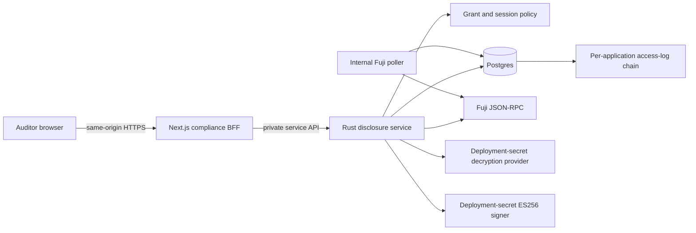
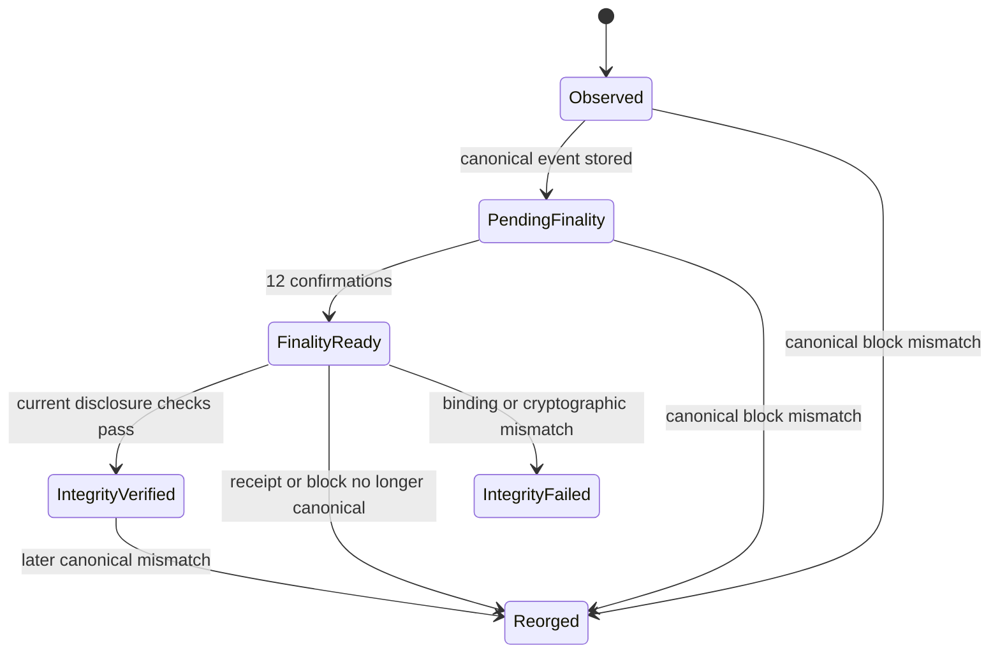

# Haze Fuji Compliance Portal Auditor Workstation Design Addendum

date: 2026-08-22
reviewed: 2026-08-23
feature: haze-avalanche-compliant-pool
status: approved Fuji MVP design; implementation remediation required
authority: Sections 6-17 supersede earlier text where they conflict

## Summary

This design addendum specifies the interaction design, layouts, states, wireframes, data contracts, and accessibility acceptance criteria for the `/audit` institutional compliance workstation on Avalanche Fuji (`chainId = 43113`).

The goal is an industrial, utilitarian, and trustworthy audit interface built strictly on Haze's alpine-volcanic design system. The Fuji MVP enables one configured institutional auditor to authenticate via SIWE, review cases for one configured application, independently verify on-chain evidence with at least 12 confirmations, decrypt five granted fields in memory, download cryptographically signed exports, and inspect hash-chained personal access logs. Production identity, key custody, retention, and multi-tenant hardening are explicit post-MVP work.

---

## 1. Visual Foundation & Palette

The `/audit` workstation adheres strictly to the existing Haze design tokens and shell:
- **CSS Variables & Palette**:
  - Background: `var(--haze-bg)` (`#16130f`)
  - Surfaces / Cards: `var(--haze-surface)` (`#221e18`)
  - Text: `var(--haze-text)` (`#f3ece2`)
  - Muted Text / Labels: `var(--haze-muted)` (`#d4c4ae`)
  - Primary Accent & Focus: `var(--haze-accent)` (`#1f6b62`) (Text: `#f3ece2`)
  - Public / Warning: `var(--haze-public)` (`#c47a3a`)
  - Private / Detail: `var(--haze-private)` (`#8ea3c7`)
  - Borders & Dividers: `var(--haze-line)` (`color-mix(in srgb, var(--haze-muted) 22%, transparent)`)
- **Typography**:
  - Primary UI & Prose: `IBM Plex Sans`, `ui-sans-serif`, `system-ui`, `sans-serif`
  - Code, Hashes, Amounts, Timestamps: `IBM Plex Mono`, `ui-monospace`, `monospace`
  - Tabular numerals enabled (`font-variant-numeric: tabular-nums`) for currency and identifiers
- **Rules**:
  - No neon teal `#00E5C9`, emoji status icons, gradients, glassmorphism, or new external CSS libraries.
  - Full-width workspace container within the existing `.haze-shell` and `.haze-stage` (bypassing the 440px pool card constraint).
  - Single header integration using existing Haze top bar (no duplicated portal header).
  - Minimum color contrast ratio >= 4.5:1 for normal text and >= 3:1 for large text / UI controls.
  - Status is never communicated by color alone: all status badges and integrity checklist items use explicit text labels and semantic accessible elements.

---

## 2. Authentication State Machine & Flow

### Unauthenticated Surface
When navigating to `/audit` without an active session, the user is presented with a single focused card: **"Fuji Auditor Access"**.

```
+-------------------------------------------------------------+
|                      HAZE COMPLIANCE                        |
|                                                             |
|  [ Fuji · 43113 ]  [ Application: 0x00...0a11 ]             |
|                                                             |
|  Institutional Auditor Sign-In                              |
|  Connect an authorized auditor wallet to inspect assigned   |
|  compliance cases and chain evidence.                       |
|                                                             |
|  [ 1. Connect Wallet ]                                      |
|                                                             |
|  -- After Connection --                                     |
|  Connected: 0xAuditor...1234                                |
|  Auditor Session Duration: 1 hour                           |
|                                                             |
|  [ 2. Review Identity & Sign with Ethereum ]                |
|                                                             |
|  [Status Banner: Polite ARIA message]                       |
+-------------------------------------------------------------+
```

### Authentication Lifecycle:
1. **Wallet Connection**:
   - Checks chain ID `43113` (Avalanche Fuji). If wrong network, prompts network switch.
   - Reads connected address.
2. **SIWE Challenge**:
   - Calls `POST /api/compliance/auth/challenge` to obtain a single-use nonce, domain, issued-at, and expiry.
   - The challenge binds the wallet, application, audience, chain, domain, and URI.
3. **EIP-191 Signature**:
   - Formats standard SIWE message:
     ```
     ${domain} wants you to sign in with your Ethereum account:
     ${address}

     Sign in to Haze Compliance Portal (Fuji)

     URI: ${uri}
     Version: 1
     Chain ID: 43113
     Nonce: ${nonce}
     Issued At: ${issuedAt}
     Expiration Time: ${expirationTime}
     Resources:
     - urn:haze:app:${applicationId}
     ```
   - User signs message with `personal_sign`.
4. **Verification & Session Creation**:
   - Calls `POST /api/compliance/auth/verify` with message and signature.
   - Backend validates nonce, domain, URI, chain, signature, application, grant status, and expiry,
     then creates an opaque hashed session stored in Postgres.
   - Sets `Set-Cookie: haze_audit_session=<token>; HttpOnly; Secure; SameSite=Strict; Path=/`.
   - Returns UI-safe `AuditSession`.
5. **Error & Recovery States**:
   - *Wrong Wallet*: Clear message "Connected wallet has no active auditor grant for application 0x...0a11" with "Connect Different Wallet" button.
   - *Signature Rejected*: "Signature was rejected in wallet. Please try again."
   - *Session Expired*: "Your auditor session has expired. Sign in again to resume."
   - *Service Unavailable*: "Compliance service is temporarily unavailable. Please retry shortly."

---

## 3. Authenticated Master-Detail Workstation

### Layout Hierarchy

#### Desktop (>= 1080px)
Three-column fixed-fluid grid:
- **Left Column (260px)**: Case Queue (assigned cases list with status and grant expiry).
- **Middle Column (Flexible / 1fr)**: Case Disclosure Record (case details, "Verify & disclose" action, decrypted fields).
- **Right Column (280px)**: Integrity & Access History Panel (12-confirmation chain verification checklist, export action, personal access log).

```
+-----------------------------------------------------------------------------------------------------------------+
| HAZE COMPLIANCE  [Fuji · 43113] [App 0x...0a11] [Auditor 0x...1234] [Sign Out]                                 |
+-------------------+---------------------------------------------------------+-----------------------------------+
| ASSIGNED CASES    | CASE: fuji-withdrawal-8218e5a4                          | INTEGRITY & FINALITY              |
| [Search Cases...] | Fuji USDC Withdrawal Investigation                      |                                   |
|                   | Case: [Active]  Evidence: [Verified]                    | [x] 12+ Confirmations (58 blocks) |
| > Case 8218e5a4   | Tx: 0x8218...8a03 [Copy] [Snowtrace]                    | [x] Canonical Receipt & Block 0x1 |
|   Withdrawal 1M   |                                                         | [x] PrivateTransaction Event      |
|   [Active]        | Granted Fields:                                         | [x] App & Action Bound (Withdraw) |
|                   | [tx_hash] [amount] [asset] [timestamp] [policy_version] | [x] Envelope Hash Verified        |
|   Case 9b12c4d1   |                                                         | [x] Audit Commitment Matched      |
|   Deposit 500k    | [ Verify & Disclose Evidence ]                          |                                   |
|   [Closed]        | ------------------------------------------------------- | EXPORT                            |
|                   | DISCLOSED RECORD                                        | [ Download Signed Export ]        |
|                   | Transaction Hash: 0x8218e5a4...232c8a03                 |                                   |
|                   | Amount:           1.000000 USDC                         | PERSONAL ACCESS HISTORY           |
|                   | Asset:            0x54258902...11a31Bc65                | 09:15:20 query (allowed)          |
|                   | Timestamp:        2026-08-21 23:05:12 Local (UTC)       | 09:14:02 login (allowed)          |
|                   | Policy Version:   1                                     | 08:30:11 export (allowed)         |
+-------------------+---------------------------------------------------------+-----------------------------------+
```

#### Tablet (720px - 1079px)
Two-column layout:
- Left: Case Queue (240px).
- Right: Main Case Record; Integrity Panel and Personal Access History flow underneath the disclosure record.

#### Mobile (< 720px)
Single-column view transition:
- Default view: Assigned Cases list.
- Tapping a case switches to the full-width Case Record view with a prominent `[<- Back to Cases]` button in the top navigation bar.
- Export review opens in a sliding bottom sheet with full touch/keyboard focus trap.

---

## 4. Workstation Components & Behavior

### 4.1 Case Queue
- Renders cases allowed by the authenticated auditor's explicit case-scope mode for exactly one
  active application.
- Displays case ID, short title, status pill (`Active`, `Disclosed`, `Expired`, `Revoked`), and grant expiration.
- Keyboard accessible: Arrow up/down to navigate, Enter/Space to select, Tab into details.

### 4.2 Case & Disclosure Record
- **Header**:
  - Case Title & Identifier (`fuji-withdrawal-8218e5a4`)
  - Application ID (`0x0000000000000000000000000000000000000000000000000000000000000a11`)
  - Target Transaction Hash with 1-click clipboard copy and Snowtrace link (`https://testnet.snowtrace.io/tx/...`)
  - Tags for granted fields: `tx_hash`, `amount`, `asset`, `timestamp`, `policy_version`. Forbidden fields (`user`, `counterparty`) are explicitly omitted.
- **Primary Action: "Verify & Disclose"**:
  - Triggers revalidation of chain finality and authorization, followed by in-memory decryption.
  - States:
    - `Idle`: Ready to verify.
    - `Verifying`: Spinner with polite announcement "Verifying chain evidence and confirmations...".
    - `Disclosed`: Displays tabular disclosed values and the server-returned passed checks.
    - `Insufficient Confirmations`: Displays warning "Transaction has only N confirmations (< 12 required). Disclose locked until finality is reached."
    - `Integrity Failure`: Shows error banner "Integrity verification failed: envelope hash or commitment mismatch."
    - `Expired / Revoked`: "Case grant has expired or was revoked."
- **Disclosed Record Table**:
  - Formatted strictly according to institutional compliance standards:
    - `tx_hash`: Full hash with copy button and external link.
    - `amount`: Formatted from 6-decimal base units (`1000000` -> `1.000000 USDC`).
    - `asset`: Circle USDC Fuji address (`0x5425890298aed601595a70AB815c96711a31Bc65`).
    - `timestamp`: Formatted in local browser time with exact UTC ISO string available on toggle/hover.
    - `policy_version`: Numeric version string.

### 4.3 Integrity & Finality Panel
Presents 6 distinct integrity verification checks:
1. **12+ Confirmations**: Current block minus receipt block plus one >= 12.
2. **Canonical Receipt**: Status `0x1` and valid block hash.
3. **Event Verification**: `PrivateTransaction` emitted on configured `HazePool`.
4. **Action Binding**: Action equals `WITHDRAW` (3) and application ID matches.
5. **Envelope Hash**: `keccak256(envelope)` equals stored `auditCiphertextHash`.
6. **Audit Commitment**: Recomputed Poseidon commitment from decrypted facts matches on-chain `auditDataCommitment`.

Each check displays:
- Semantic icon plus explicit `Passed`, `Failed`, or `Pending` text using existing status tokens.
- Label and technical evidence detail (e.g. `58 confirmations`, `Block #57897923`).

### 4.4 Export Review Modal / Bottom Sheet
- The "Export" button is disabled until disclosure succeeds.
- Clicking "Export" opens a modal (desktop/tablet) or bottom sheet (mobile) containing:
  - Export Metadata: Case ID, auditor address, application ID, signing key ID,
    algorithm (`ES256`), schema version, and expiry timestamp (10 minutes).
  - Scope: Exact list of granted fields.
  - Verification Hash: SHA-256 of the RFC 8785 canonical export payload.
  - Detached Signature: Base64url-encoded ES256 detached JWS.
  - Primary Action: `[ Download Signed JSON ]`.
- Closing the modal restores focus to the Export trigger button.

### 4.5 Personal Access History
- Displays the auditor's recent access logs.
- Refreshes automatically whenever a disclosure query or export is performed.
- Columns: Timestamp (HH:MM:SS), Operation (`query`, `export`, `auth`), Result (`ALLOWED` / `DENIED`).
- Disclosed plaintext values are never included in the access log.

---

## 5. Accessibility Acceptance Criteria

1. **Keyboard Navigation**:
   - All interactive controls reachable via standard Tab sequence.
   - Arrow navigation within case queue.
   - Escape closes modals and bottom sheets.
   - Focus trapped within active dialogs; returned to trigger on close.
2. **Screen Reader Announcements**:
   - `aria-live="polite"` region for status updates (verifying, disclosed, exported, errors).
   - Semantic landmarks: `<header role="banner">`, `<nav aria-label="Assigned cases">`, `<main id="content">`, `<aside aria-label="Integrity and activity">`.
3. **Contrast & Motion**:
   - Minimum 4.5:1 text contrast across all surfaces.
   - Respects `prefers-reduced-motion: reduce` (disables transitions and spinners).
4. **Mobile Usability**:
   - All interactive targets meet minimum 44px x 44px hit area.
   - No horizontal scrolling at 390px viewport width.

---

## 6. Approved Fuji MVP Boundary

This addendum is a delivery slice, not closure of every production requirement in the parent feature.
The MVP ships one public Fuji auditor journey quickly while preserving the security properties needed
for a truthful demonstration.

### In scope

- One configured Fuji application and one configured auditor wallet.
- The existing one-origin Next.js application, same-origin BFF routes, Rust disclosure service,
  durable Postgres runtime, and real Fuji RPC evidence.
- SIWE authentication with unpredictable challenges and sessions.
- Automatic log ingestion and backfill, 12-confirmation finality, canonical receipt/event binding,
  in-memory disclosure, and five-field redaction.
- A real ES256 export signature using a deployment-secret key and a configured public JWK.
- Transactional, per-application hash-chained access logs in Postgres.
- A responsive, accessible, truthful workstation and one deployed Fuji walkthrough.

### Explicit post-MVP work

- Organizational OIDC/SAML identity.
- Cloud KMS custody for decryption and signing keys.
- Write-once retention replication.
- PostgreSQL row-level security.
- Key rotation and historical key publication.
- Multi-organization, multi-application production tenancy, and super-auditor access.
- A fresh deposit-to-withdraw Dappwright run and production release-evidence manifest.

These deferrals do not weaken the parent requirements. The Fuji MVP must not be described as
production-ready or as satisfying the deferred parts of FR-08, FR-09, SC-03, or SC-04.

## 7. MVP Architecture and Trust Boundaries



- The browser never receives decryption or signing key material.
- The BFF forwards the HttpOnly session cookie and exposes no generic service proxy.
- The poller may create or advance a case only from RPC-returned data.
- The disclosure service is the sole authority for grant evaluation, evidence checks, field
  redaction, export authorization, and access-log writes.
- Postgres is the MVP durable system of record. A database or required log-write failure prevents
  plaintext or export release.

The deployment-secret providers retain the existing KMS-style interfaces so cloud custody can
replace them without changing disclosure or export contracts.

## 8. Identity, Session, and Authorization Contract

### Challenge and session security

- Challenge handles and session bearer tokens contain at least 256 bits from the operating system
  CSPRNG. SIWE nonces contain at least 128 bits of entropy and meet EIP-4361 encoding constraints.
- Challenges expire after five minutes, are consumed atomically exactly once, and bind wallet,
  application, chain `43113`, domain, URI, audience, issue time, and expiry.
- Postgres stores a one-way digest of the bearer token, never the raw session token. Sequence IDs,
  timestamps, labels, hashes of public data, or deterministic PRNG output are forbidden as secrets.
- Sessions have a one-hour absolute lifetime and no silent refresh. Logout revokes the server-side
  session before clearing the cookie.
- The cookie is HttpOnly, Secure, SameSite=Strict, and host-only in the deployed environment. The BFF
  rejects state-changing requests from an unexpected `Origin`.

### Grant scope

```text
CaseScope =
  | { kind: "explicit_cases", case_ids: NonEmpty<CaseId> }
  | { kind: "all_application_cases" }
```

The MVP grant uses `all_application_cases` for the single configured application. An empty case list
has no wildcard meaning and is rejected during grant decoding. Every session binds exactly one
wallet, role, `application_id`, field set, case scope, issue time, and expiry.

Session information, case listing, disclosure, export, and access-history routes all revalidate:

1. session expiry and revocation;
2. current grant expiry and revocation;
3. exact wallet and application binding;
4. case scope and case lifecycle; and
5. the requested five-field scope.

Every case and evidence repository operation takes `(application_id, case_id)`. Tenant-bearing tables
carry `application_id`, and related rows use composite application/case constraints where practical.
The MVP does not add RLS, but repository and HTTP tests must use a second fixture application and
prove cross-application denial.

## 9. Canonical Evidence and Disclosure

The poller stores an evidence snapshot containing chain ID, target transaction hash, receipt status,
block number and hash, log index, pool address, event topic and data, application ID, action,
action reference, pool version, ciphertext and ciphertext hash, audit commitment, observed head, and
confirmation count. Each value must come from the configured Fuji RPC response or verified event
data; the service must never synthesize a successful receipt, action reference, pool version, or
integrity result.

Case lifecycle and evidence status are independent:



An `active` case is not automatically verified. `FinalityReady` means only that the indexed evidence
has reached 12 confirmations. A disclosure request performs this fail-closed sequence:

1. Revalidate session and grant; fetch the case by application and case ID.
2. Re-fetch the target transaction, receipt, containing block, and exact log from Fuji RPC.
3. Require the requested hash to equal the transaction and receipt hashes, receipt status `1`, the
   stored block hash to remain canonical, and confirmations to remain at least 12.
4. Require the configured HazePool address, `PrivateTransaction` topic, log index, application ID,
   `WITHDRAW` action, action reference, pool version, ciphertext hash, and commitment to match.
5. Decrypt the envelope in memory, recompute its hash and Poseidon audit commitment, and zeroize key
   and plaintext buffers as supported by the existing service boundary.
6. Return exactly `tx_hash`, `amount`, `asset`, `timestamp`, and `policy_version`, plus typed checks.
   `policy_version` must come from verified evidence; missing data fails closed.
7. Commit the allowed access-log entry before returning plaintext.

`user` and `counterparty` remain denied by the D8 policy and never enter browser responses, DOM,
downloads, or access logs.

## 10. API and Truthful UI Contract

The browser uses only the existing same-origin routes:

- `POST /api/compliance/auth/challenge`
- `POST /api/compliance/auth/verify`
- `GET /api/compliance/session`
- `GET /api/compliance/cases`
- `POST /api/compliance/cases/:caseId/disclosure`
- `POST /api/compliance/cases/:caseId/export`
- `GET /api/compliance/access-log`
- `POST /api/compliance/logout`

A successful disclosure returns the five disclosed fields and all checks in this shape:

```json
{
  "checks": [
    {
      "id": "canonical_receipt",
      "status": "passed",
      "observed": "status=1 block=0x...",
      "expected": "successful receipt in canonical block"
    }
  ]
}
```

Check status is `pending`, `passed`, or `failed`. The UI does not derive a passed check from case
existence, confirmation count, or a previous response. A missing or unknown required check is shown
as unavailable and keeps disclosure/export locked. `Verified` appears only after every required check
passes in the current disclosure operation.

Stable failures include `INVALID_BINDING`, `SESSION_EXPIRED`, `GRANT_DENIED`,
`APPLICATION_MISMATCH`, `CASE_SCOPE_DENIED`, `INSUFFICIENT_FINALITY`,
`CANONICAL_EVIDENCE_MISMATCH`, `INTEGRITY_MISMATCH`, `RPC_UNAVAILABLE`, and
`AUDIT_LOG_UNAVAILABLE`. Messages remain actionable without exposing internal details or secrets.

## 11. Export Authenticity

- The export payload has a versioned schema and includes export ID, application ID, case ID, auditor
  wallet, exact fields and values, evidence provenance, issue time, and ten-minute authorization
  expiry.
- The service serializes the payload using RFC 8785 JSON Canonicalization Scheme and computes its
  SHA-256 digest for display.
- A distinct P-256 private key loaded from the deployment secret signs a detached ES256 JWS. The
  protected header contains `alg`, immutable `kid`, `typ`, and schema version.
- The configured public JWK is exposed through a read-only well-known endpoint and bundled with the
  independent verifier. The verifier reconstructs the signing input, checks the JWS signature,
  payload digest, schema, application/case scope, and expiry.
- Signature validity and authorization expiry are reported separately. Recomputing a public digest
  and placing it in the signature field is explicitly invalid.
- Export requires a successful disclosure in the same live session and a fresh grant revalidation.

Key rotation and historical publication are post-MVP. The single MVP key ID is immutable for the
deployed candidate, and changing it requires a new candidate deployment.

## 12. MVP Access Log

Every allowed or denied authentication, case query, disclosure, export, and verification attempt
records the wallet, application, optional case, requested field names, grant identifier, operation,
result, stable reason code, and timestamp. Entries never include plaintext, cookies, session tokens,
SIWE messages, signatures, or private key material.

Postgres assigns a serialized per-application sequence and stores `prev_hash` and `entry_hash` under
a transactionally locked chain head. A plaintext or export response is not released unless its
allowed entry commits. Ordinary auditors see only their own history.

Write-once replication and signed retention checkpoints are deferred. The UI and release copy must
therefore say `hash-chained access history`, not `write-once retained audit log`, for the MVP.

## 13. Workstation UX States

The primary journey remains intentionally short:

1. Connect the configured auditor wallet and sign in with Ethereum.
2. Select an authorized case from a real queue or `?case=<id>` deep link.
3. Read one of `Syncing`, `Awaiting finality`, `Ready to verify`, `Verified`, or
   `Verification failed` from server state.
4. Run `Verify & Disclose` and inspect the six returned checks.
5. Review the five disclosed values, download the signed export, and see the refreshed history.
6. Sign out.

No organization selector, admin/governance controls, role query controls, transaction balances,
cloud-provider health, or production-readiness language appears in the MVP auditor experience.
Desktop retains the three-column workstation; tablet stacks integrity below the record; mobile uses
case-list/detail navigation. Search has a visible label, desktop and mobile targets are at least
44px, dialogs trap and restore focus, and all status meaning is available as text.

## 14. Operational Behavior

- Required readiness covers Postgres migrations, Fuji RPC, configured pool/application data,
  decryption secret, export signing key/public JWK agreement, and the internal poller.
- The service is not ready if it would be unable to authenticate, verify evidence, decrypt, sign, or
  durably record access. It does not need OIDC, cloud KMS, WORM, or RLS readiness in MVP mode.
- Logs and metrics contain reason codes, timings, application/case identifiers where appropriate,
  and correlation IDs, but no bearer secrets, signatures, envelope plaintext, or disclosed values.
- Postgres indexes cover active grant lookup, session digest/expiry, application-scoped case order,
  canonical evidence uniqueness, poller checkpoints, and access-log sequence.
- Local bootstrap applies the same compliance migrations as the deployed service.
- Existing `fuji-v1.json`, SC-09, production ceremony state, and mainnet authorization remain
  unchanged and fail closed.

## 15. MVP Validation and Rollout

### Automated gates

- Auth: unpredictable distinct challenges/sessions, one-time challenge use, replay rejection, expiry,
  logout, and grant revocation.
- Isolation: repository and HTTP denial for a second application and out-of-scope case.
- Evidence: target transaction, failed receipt, block hash, log address/topic/index, application,
  action, action reference, pool version, confirmations, ciphertext hash, and commitment failures.
- Disclosure: exactly five fields, no forbidden values in JSON, DOM, export, or logs.
- Export: RFC 8785 determinism, independent ES256 verification, tamper rejection, and expiry result.
- Persistence: migrations, restart recovery, poller idempotency/reorg handling, and hash-chain
  tampering detection.
- Browser: built Next.js desktop and mobile journeys, keyboard/focus behavior, missing-data states,
  error recovery, access history, and logout.

The acceptance runner exits non-zero at the first failed required assertion. It cannot skip auth,
verification, disclosure, export verification, access history, or logout and still print `PASS`.

### Deployed Fuji acceptance

The poller may backfill and independently verify the already-known D7 withdrawal transaction from
Fuji. MVP acceptance does not require a new deposit/withdrawal, two Dappwright profiles, or an
extensive production manifest. One visible production-site walkthrough records the deployed commit,
transaction hash, dynamic case ID, confirmation count, returned integrity checks, exact disclosed
field names, export payload hash and independent signature result, access-log head, and logout.

Dependency upgrades are deferred unless an advisory affects the shipped runtime path or blocks the
MVP build and walkthrough.

## 16. Requirements Coverage and Named Deferrals

| Requirement | MVP coverage |
|---|---|
| Audit goal and auditor investigation stories | Real Fuji case queue, canonical evidence, five-field disclosure, export, and personal history |
| FR-06 truthful audit binding | Full target transaction, receipt, event, envelope, and commitment verification |
| FR-07 finalized indexing | Durable idempotent poller, canonical block tracking, 12 confirmations, and reorg lockout |
| FR-08 organizational identity plus SIWE | SIWE is covered; organizational OIDC/SAML is a named post-MVP deferral |
| FR-09 scoped disclosure and logging | Grant revalidation, exact fields, in-memory decryption, and Postgres hash chain; cloud KMS and WORM are deferred |
| SC-03 portal investigation/export | Covered for one configured application and auditor; production organization administration is deferred |
| SC-04 tenant and super-auditor isolation | Application-scoped code and tests are covered; RLS and super-auditor flow are deferred |
| SC-08 branch/failure tests | Covered by the automated gates in Section 15 |
| SC-10 truthful product copy | UI shows only server checks and uses explicit Fuji MVP language |

No parent requirement is removed. Production readiness returns to requirements/design review for the
deferred controls before a mainnet or institutional release claim.

## 17. Alternatives, Decision, and Implementation Routing

Three cuts were considered:

1. **UX-first safe Fuji slice — chosen.** Preserves real auth secrets, authorization, chain evidence,
   field redaction, signatures, and persistence while deferring provider-heavy controls.
2. **Mocked UI prototype — rejected.** Faster visually but cannot support truthful verification or a
   shipped public Fuji claim.
3. **Production-shaped pilot — deferred.** Real OIDC/SAML, cloud KMS, WORM, RLS, rotation, and fresh
   transaction choreography add schedule risk without improving the core MVP investigation UX.

Implementation returns to Phase 5 and should proceed in this order: secure auth and scope; canonical
evidence; ES256 export; truthful API/UI states; focused persistence/access-log parity; browser quality;
then the simplified Fuji walkthrough. Phase 7 must be rerun before deployed acceptance.
