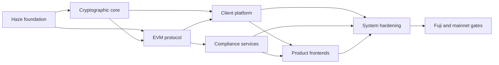

# Haze Avalanche Compliant Pool Implementation Plan

## Planning Approach

Haze spans circuits, EVM contracts, an SDK, four security-sensitive services, two frontend
deployments, and production ceremony/audit work. It is a product program rather than a single patch.
The milestones below preserve one approved product architecture while isolating implementation into
reviewable workstreams. Each milestone should receive a focused design review before implementation
if it introduces more detail than the approved umbrella design.

No calendar commitments are assigned until staffing and external provider/auditor availability are
known. Ordering is dependency-based. A milestone exits only with the listed fresh validation evidence.

## Milestones

- [x] **M0 — Haze foundation:** independent product boundary, canonical protocol specification,
  provider-neutral interfaces, deterministic local environment, and CI are ready.
- [x] **M1 — Cryptographic core:** reviewed note/policy primitives, 2-input/2-output circuits,
  cross-language vectors, prover artifacts, and ceremony tooling pass circuit tests.
- [x] **M2 — EVM protocol:** verifier, registries, HazePool, swap-and-shield router, emergency exit,
  and Foundry security suites pass locally with gas baselines.
- [x] **M3 — Client platform:** TypeScript SDK, browser prover, encrypted vault, note synchronization,
  and complete user workflows operate against local contracts.
- [x] **M4 — Compliance services:** gatekeeper, indexer, audit authorization, disclosure, KMS adapters,
  durable storage, and tamper-evident access logs pass integration tests.
- [x] **M5 — Product frontends:** the Privacy Pool DEX and separate Compliance Portal cover their
  approved roles and pass accessibility, authorization, and workflow tests.
- [x] **M6 — System hardening:** all local end-to-end, adversarial, performance, recovery,
  observability, and incident-runbook checks pass.
- [ ] **M7 — Fuji and mainnet gates:** Fuji pilot, independent audit/remediation, production ceremony,
  and operational approval are complete before mainnet activation is considered.

## Progress Update — 2026-08-10

T0.1 is complete: Haze now has an independent, buildable multi-language product boundary with an
architecture test that rejects prohibited dependencies and public re-exports. No scope changes,
new tasks, or implementation blockers were discovered.

T0.2 is complete: encodings, committed vectors, four-language harnesses, and ADRs are in the
worktree. Local review `7235304c` closed lockstep gaps. Independent review `91cfa5ee` accepted
encodings with follow-ups; those follow-ups are implemented. Product approved
`docs/ai/design/2026-08-17-t0.2-product-approval-packet.md` in-thread on 2026-08-17 with no
conditions. T0.3 provider-neutral interfaces and mocks are implemented; vendor SDKs are not public
types. T0.4 toolchain lock, local mock EVM tokens, development circuit-artifact gate, Postgres
migration stub, secret scan, and staged `.github/workflows/haze.yml` are in place. T1.1 is complete:
Circom 2.2.3 independently reproduces the v1 Poseidon2 sponge against committed vectors; incompatible
Stellar artifacts are documented in `haze/circuits/REJECTION.md`. T1.2 is complete: the versioned
2-in/2-out spend circuit witnesses deposit, transfer, and withdraw; invalid witnesses fail; public
inputs and `n_constraints = 588459` are pinned. T1.3 is complete: Rust and TypeScript proving
packages share EIP-712/HKDF/HPKE keys, 29 spend public inputs, and artifact hashes. T1.4 is complete:
circuit-build manifests, rehearsal contribution verification, development verifier generation, artifact
signing, and SC-09 provenance exist; spend Groth16 still returns `KEYS_MISSING` until T7.4.
T2.1–T2.6 are complete: spend verifier wrapper, registries, HazePool, SwapAndShieldRouter,
EmergencyExit, Foundry invariant handlers, and local/Fuji-ready gas budgets exist. M2 is complete.
T3.1–T3.4 are complete: TypeScript SDK transports, vault, workflows, and node-free browser proving.
T4.1 is complete: `haze-gatekeeper` is the reference in-process application gatekeeper
(`Gatekeeper::authorize` is the `POST /v1/authorizations` semantic; no HTTP listener). T4.2 is
complete: `haze-indexer` is the reference in-process auditability indexer (`Indexer::ingest` /
`Indexer::sync` are the event-ingestion semantic; no HTTP listener). T4.2a is complete: protocol
artifact/verify APIs, public `Indexer::haze_witness`, and authenticated
`Gatekeeper::application_witnesses` (no HTTP listener). T4.3 is complete: `haze-audit-auth` is the
reference in-process institutional authorization service (`AuditAuth::challenge` / `token` /
`create_case` / `update_case` / `delegate` / `revoke` / `authorize` are the `/v1/auth/*` and
`/v1/cases` semantic; no HTTP listener). T4.4 is complete (library disclosure/KMS/export/access-log).
T4.5 is complete (library health/ready, migrations, idempotency, retention, backup/restore). M4 is
complete. T5.1 is complete: Haze UX contracts, alpine-volcanic design tokens, role/route/API
guards, privacy-copy glossary, and accessibility primitives. T5.2 is complete: library-first
Privacy Pool DEX (`createDexApp`) covers wallet onboarding and the six user workflows with
public warnings before signature. T5.3 is complete: library-first application administration
workspace (`createAdminWorkspace`) covers manifest/KMS, gatekeeper signer, auditor delegation,
cases, application reports, scoped export, and revoke. T5.4 is complete: library-first
auditor investigation workspace (`createAuditWorkspace`) covers SIWE binding, assigned
cases, field-limited search/export, expiry/revocation, and personal access history.
T5.5 is complete: library-first Haze governance workspace (`createGovernanceWorkspace`)
covers timelocked schedules, exact on-chain preview, versions/ceremony provenance,
suspensions/emergency status, and super-auditor grants without custody. M5 is complete
at the library layer. Hosted Next.js remains T6.2. Fuji re-measure remains required
before mainnet. T7.4 remains the **documented-rehearsed** package; published production
keys are still missing. 2026-08-18 adds operator-owned `haze-spend-v1` snarkjs pipeline
work (ptau 20, phase-2, export) without flipping SC-09 or committed `fuji-v1.json`.
A one-laptop run is not `production_ceremony.approved`.

Commercial one-origin host (2026-08-18 Phase 5 C0–C7): wallet-from-address grants, review-then-sign,
hydrated pool + compliance workspaces, IBM Plex, playwright-cli walk on 3010. dappwright package
not installed — MetaMask headed bootstrap is operator-owned. SC-09 and fuji-v1 stay closed.

## Progress Update — 2026-08-22 (D8 Reconciliation — Fresh Fuji Deposit-to-Compliance Production E2E)

D8 is reopened as in progress. Verified local implementation is preserved while unsupported production-complete claims are removed:
1. **Design Baseline & Compatibility (`D8.0` & `D8.0b`):** Draft baseline in `docs/ai/design/2026-08-22-fuji-compliance-auditor-workstation.md` is retained (`D8.0`); responsive compatibility using existing Haze tokens (`#1f6b62`), shell integration, and product review remains open (`D8.0b`).
2. **Local Cryptography & Auth (`D8.1`):** Rust local SIWE, session, grant, 12-confirmation check, disclosure redaction, signed export, and hash-chained access logging are complete locally with existing Rust evidence.
3. **Durable Runtime & Automatic Ingestion (`D8.2`):** Open. Postgres-backed state and automatic Fuji log poller required (no in-memory production state or hardcoded seeded case).
4. **BFF Routes (`D8.3`):** Same-origin Next.js BFF routes are complete locally; production deployment and upstream identity are open.
5. **React Workstation Client (`D8.4`):** In progress. Full-width shell integration, accessible dialogs/focus trapping, `?case=<id>` deep links, genuine empty states, privacy hygiene, and responsive layout remediation required.
6. **Fresh Production E2E & Walkthrough (`D8.5` & `D8.6`):** Open. Fresh Fuji deposit→withdraw→auditor SIWE journey and named `playwright-cli` session investigation with real production evidence required.
7. **Product / UI Quality Gate (`D8.7`):** Open. Responsive WCAG AA review and visual hierarchy remediation.

Next three tasks: (1) durable automatic Fuji ingestion (`D8.2`), (2) workstation UX remediation (`D8.4`), and (3) composed production E2E and product review (`D8.5`–`D8.7`).

## Task Breakdown

### M0 — Haze foundation

- [x] **T0.1 — Establish the Haze product boundary.**
  - Outcome: create isolated Haze directories/packages for Solidity contracts, circuits/prover,
    services, TypeScript SDK, Privacy Pool DEX, Compliance Portal, deployments, and tests; no public
    Haze API imports Stellar/Soroban/SEP/Freighter modules.
  - Dependencies: approved requirements/design.
  - Validation: workspace builds empty/minimal packages, dependency graph review, and an architecture
    test or lint rule rejects prohibited Stellar dependencies.
  - Coverage: product non-goals, `FR-10`, compatibility/version startup tests.
  - Evidence (2026-08-10): the nested Rust workspace, Node workspace, and Foundry project build;
    `haze/tests/product-boundary.test.mjs` verifies the required package set and rejects prohibited
    dependencies, ordinary imports, Rust public re-exports, and TypeScript public re-exports.

- [x] **T0.2 — Freeze canonical protocol encodings and threat model.**
  - Outcome: specify field domains, integer ranges, note/commitment/nullifier formulas, app-scoped
    Haze addresses, recipient-note encryption, canonical audit-data commitments/envelopes, Merkle
    conventions, application/policy/version binding, EIP-712 types, and explicit trust boundaries in
    language-neutral test vectors and ADRs.
  - Dependencies: T0.1.
  - Validation: independent cryptography and EVM review of the spec; vectors load identically in
    Rust, Circom, Solidity, and TypeScript harnesses.
  - Coverage: all circuit/cryptography unit scenarios and `FR-01` through `FR-06`.
  - Evidence (2026-08-17): independent review `91cfa5ee` accepted encodings; follow-ups implemented;
    product approved `docs/ai/design/2026-08-17-t0.2-product-approval-packet.md` with no conditions.

- [x] **T0.3 — Select providers behind approved interfaces.**
  - Outcome: evaluate and record the MVP DEX quote/adapter, C-Chain RPC, KMS, OIDC/SAML, object-storage,
    and hosting choices without exposing provider-specific types through Haze public APIs.
  - Dependencies: T0.1 and security/privacy requirements.
  - Validation: ADRs document security, availability, pricing, data-residency, fallback, and exit risks;
    contract/service interfaces run against mocks before a provider is accepted.
  - Coverage: swap quote, KMS/identity outage, and provider-neutral integration scenarios.

- [x] **T0.4 — Build deterministic development and CI foundations.**
  - Outcome: lock toolchains, add a local EVM environment, mock USDC/source tokens/DEX/KMS/OIDC,
    PostgreSQL migrations, development-only circuit artifacts, secret scanning, and staged CI jobs.
  - Dependencies: T0.1 and T0.2.
  - Validation: clean bootstrap reproduces builds and fixture hashes; CI proves development artifacts
    cannot be selected by production configuration.
  - Coverage: Testing Strategy test-data requirements and reporting baseline.

### M1 — Cryptographic core

- [x] **T1.1 — Review and adapt reusable privacy primitives.**
  - Outcome: reuse only audited-compatible Poseidon2, Merkle, note, nullifier, ASP, and encryption
    concepts; replace Stellar-specific field/address/event assumptions with canonical EVM encodings.
  - Dependencies: T0.2 and T0.4.
  - Validation: vector suite, differential tests against approved legacy primitives, and documented
    rejection of incompatible code/artifacts.
  - Coverage: commitment, nullifier, Merkle, policy, address-field, and version-mismatch unit tests.
  - Evidence (2026-08-17): Circom 2.2.3 at `haze/.tools/bin/circom` witnesses sponge, Merkle, note,
    nullifier, and application-member gadgets against committed vectors; `REJECTION.md` plus
    `circuit-reuse.test.mjs` reject Stellar `Poseidon2(n)` and transaction/SMT/policy artifacts;
    `primitives.rs` 5/5 including legacy perm ≠ sponge and version/chain/application mismatch.

- [x] **T1.2 — Implement the versioned 2-input/2-output transaction circuits.**
  - Outcome: support direct shield, same-application private transfer/change, normal withdrawal,
    active application membership plus Haze global non-membership for every enabled input/output,
    value conservation, recipient ciphertext hashes, and circuit-recomputed audit-data commitments.
  - Dependencies: T1.1.
  - Validation: `haze/tests/circuit-spend.test.mjs` 11/11; Rust `spend` 5 passed, 1 ignored write
    helper; Circom 2.2.3 compile reports 29 public inputs and `n_constraints = 588459`. Emergency
    exit remains a separate circuit (T2.x / later). Policy-registry freshness and proving-key hashes
    remain T2.2 (now complete) / T7.4.
  - Coverage: `FR-01`, `FR-02`, `FR-04`, `FR-06`; circuit/cryptography unit scenarios.

- [x] **T1.3 — Implement Rust and browser proving packages.**
  - Outcome: produce the same witness/public inputs and proof from Rust and browser workers; expose
    cancellation, progress, memory clearing, artifact hashing, and typed errors.
  - Dependencies: T1.2.
  - Validation: cross-runtime proof/verifier tests, browser memory/profile tests, and initial P95
    proving benchmarks.
  - Coverage: SDK key/prover tests, proof integration test, `SC-05`, and `SC-06`.
  - Evidence (2026-08-17): `haze-prover` and `haze/sdk/typescript/src/prover.ts` share
    `haze-prover-v1.json` (typed digest, HKDF secrets, X25519, 29 public inputs, artifact hash).
    Spend prove returns `KEYS_MISSING`. Development Groth16 is a tiny equality circuit (Rust
    arkworks verifies; TS records a same-stack development proof). Session cancel/clear/progress
    covered. `SC-05` re-derives keys from the wallet message. Spend P95 (`SC-06`) is T6.3;
    T1.3 records development-circuit duration only. Ceremony keys remain T7.4.

- [x] **T1.4 — Create reproducible artifact and ceremony tooling.**
  - Outcome: deterministic circuit build manifests, development setup scripts, contribution
    verification, production ceremony runbook, artifact signing, and provenance display data.
  - Dependencies: T1.2.
  - Validation: two clean builds match source/constraint hashes; a rehearsal ceremony verifies every
    contribution and generated Solidity verifier.
  - Coverage: artifact/version tests, `SC-09`, and manual ceremony checks.
  - Evidence (2026-08-17): two clean equality-circuit builds match r1cs hashes; spend manifest pins
    source/fixture hashes and `n_constraints = 588459`; rehearsal transcript verifies two
    contributions; generated development verifier is `NOT_FOR_PRODUCTION`; signed manifest recovers
    `0x7e5f…5bdf`; SC-09 provenance keeps all four gates closed; spend prove stays `KEYS_MISSING`.

### M2 — EVM protocol

- [x] **T2.1 — Generate and wrap the immutable Groth16 verifier.**
  - Outcome: versioned Solidity verifier with canonical public-input checks, artifact hashes, and no
    proxy/admin mutation path.
  - Dependencies: T1.2 and T1.4.
  - Validation: valid Rust/browser proofs verify; malformed/mismatched proofs and artifacts fail;
    gas snapshot recorded.
  - Coverage: verifier contract and cross-language proof scenarios.
  - Evidence (2026-08-17): `HazeSpendVerifier` is immutable (no owner/proxy/admin); 29 public-input
    checks plus T1.3 artifact hash; deposit/transfer/withdraw fixtures verify in Solidity, Rust, and
    TypeScript; production selection is `KEYS_MISSING`; `verify()` gas is 15214. Ceremony-bound
    spend pairing remains T7.4.

- [x] **T2.2 — Implement application, policy, and version registries.**
  - Outcome: multisig/timelock-controlled application lifecycle, gatekeeper rotation, signed-manifest
    references, app-controlled KYC membership roots, timelocked Haze global blocklist roots with no
    stale-proof grace period, contract releases, and separate emergency roles.
  - Dependencies: T0.2 and T0.3.
  - Validation: Foundry `RegistriesTest` 15/15 including 3 fuzz tests; Node `registry.test.mjs` 2/2;
    protocol `registry` unit tests lock status discriminants and no-grace freshness. HazePool remains
    T2.3. Emergency-exit contract remains T2.5. `E2E-08` remains later governance-workspace work.
  - Coverage: `FR-04`, `FR-11`, registry unit scenarios. Emergency-exit and `E2E-08` stay open.

- [x] **T2.3 — Implement HazePool deposit and private transaction paths.**
  - Outcome: exact USDC custody, commitment/root history, nullifier consumption, proof verification,
    application and EIP-712 authorization, strict input/output policy validation, withdrawals, bound
    recipient ciphertexts, truthful audit commitment/ciphertext events, direct-caller enforcement,
    and a narrowly scoped approved-router deposit entry point with original-payer binding.
  - Dependencies: T2.1 and T2.2.
  - Validation: unit/fuzz/invariant tests prove conservation and reject every authorization, proof,
    policy, application, root, nullifier, ciphertext, and token failure mode.
  - Coverage: `FR-01` through `FR-04`, `FR-06`, `E2E-01`, `E2E-03` through `E2E-05`.

- [x] **T2.4 — Implement the swap-and-shield router and adapter boundary.**
  - Outcome: allowlisted token/adapter routing, exact balance-delta accounting, slippage/deadline and
    route-hash enforcement, atomic USDC deposit, approval hygiene, and zero residual balances.
  - Dependencies: T2.3 and provider decision T0.3.
  - Validation: ordinary and adversarial token/adapter fuzz tests plus invariant tests show failed
    routes revert and successful routes leave no funds or approvals behind.
  - Coverage: `FR-05`, SwapAndShieldRouter unit scenarios, `E2E-02`, and `E2E-11`.

- [x] **T2.5 — Implement pause, emergency exit, and version migration paths.**
  - Outcome: scoped pauses, always-available seven-day exit requests, Haze-global-policy-only exit
    execution, normal withdrawals during cooldown, old-version support windows, and public
    exit-and-re-shield migration behavior.
  - Dependencies: T2.2 and T2.3.
  - Validation: time-bound state-machine/fuzz tests reject early/replayed exits and prove governance
    cannot spend notes or bypass the active policy.
  - Coverage: `FR-12`, `FR-14`, registry/emergency unit scenarios, `E2E-09`, `E2E-13`.

- [x] **T2.6 — Complete protocol invariants and gas budgets.**
  - Outcome: invariant handlers cover all state transitions and a local/Fuji-ready gas report sets
    provisional budgets for every user/governance action.
  - Dependencies: T2.1 through T2.5.
  - Validation: sustained invariant/fuzz campaigns pass with no conservation, nullifier, authorization,
    policy, residual-balance, or role violation.
  - Coverage: `SC-02`, contract coverage goals, and performance/gas scenarios.

### M3 — Client platform

- [x] **T3.1 — Build canonical TypeScript SDK types and transports.**
  - Outcome: provider-neutral EVM transport, contract bindings, EIP-712 types, application manifest,
    quote adapter, gatekeeper API, error taxonomy, and version compatibility checks.
  - Dependencies: T0.2, T2.2, and T2.3 interfaces.
  - Validation: TypeScript consumes canonical vectors and rejects incompatible chain, contract,
    manifest, circuit, and API versions.
  - Coverage: SDK state/error tests and version integration scenarios.

- [x] **T3.2 — Implement non-custodial shielded account and local vault.**
  - Outcome: domain-separated note/X25519 key derivation, app-scoped Haze address codecs, authenticated
    recipient-ciphertext decryption, encrypted storage, commitment-verified note discovery/sync,
    recovery after local deletion, and smart-wallet compatibility error handling.
  - Dependencies: T1.1, T1.3, and T3.1.
  - Validation: deterministic recovery, vault encryption, secret/witness clearing, reorg, duplicate
    event, and lost-local-state tests pass.
  - Coverage: `FR-13`, `SC-05`, SDK/vault unit scenarios, `E2E-10`.

- [x] **T3.3 — Implement complete user transaction workflows.**
  - Outcome: quote/proof/authorization/submission/finality state machines for direct shield,
    swap-and-shield, private send, withdrawal, always-available emergency exit, and public
    exit-and-re-shield migration with stale-root/policy resync.
  - Dependencies: T2.3 through T2.5 and T3.2.
  - Validation: SDK integration tests exercise success, cancellation, wallet rejection, timeout,
    slippage, expiry, reorg, retry, and fail-closed errors.
  - Coverage: `FR-01` through `FR-06`, user E2E paths, adversarial-route integration scenarios.

- [x] **T3.4 — Package browser proving and integrator APIs.**
  - Outcome: Web Worker bundles, cache/version management, progress/cancel hooks, reference integration
    examples, and stable package documentation.
  - Dependencies: T1.3 and T3.3.
  - Validation: clean browser build, artifact integrity checks, bundle/license review, and proving P95
    benchmark on the reference desktop.
  - Coverage: `SC-06`, browser prover, manual browser, and performance scenarios.

### M4 — Compliance services

- [x] **T4.1 — Implement the reference application gatekeeper.**
  - Outcome: pluggable application authentication/KYC adapter, policy/limit checks, idempotent
    authorization nonces, input/output recipient eligibility, canonical audit-record/hidden-salt
    construction, versioned envelope encryption, EIP-712 binding, rate limiting, and typed denials.
  - Dependencies: T0.3, T2.2, and T3.1.
  - Validation: complete gatekeeper unit suite, concurrency/replay tests, key rotation/outage tests,
    and no-sensitive-log assertions.
  - Coverage: `FR-03`, gatekeeper unit scenarios, direct/transfer/withdraw integration paths.
  - Evidence (2026-08-17): converted existing `haze-gatekeeper` to lib+bin (still one of six
    workspace packages). `cargo test --manifest-path haze/services/gatekeeper/Cargo.toml --test
    gatekeeper -- --test-threads=1` 26/26. HTTP listener is not required; library `authorize()`
    is the `POST /v1/authorizations` semantic. Full-system E2E remains T5.2/T6.2.

- [x] **T4.2 — Implement the auditability indexer.**
  - Outcome: pool/router/registry event ingestion, block-hash checkpoints, finality tracking, reorg
    compensation, recipient/auditor ciphertext integrity validation, audit-data commitments,
    application partitions, and read models.
  - Dependencies: T2.2 through T2.5 and T0.4 storage.
  - Validation: duplicate delivery, restart, backlog, RPC failover, and reorg tests preserve exactly
    one correct finalized record.
  - Coverage: `FR-07`, indexer unit/integration scenarios, event-query latency target.
  - Evidence (2026-08-17): converted existing `haze-indexer` to lib+bin (still one of six workspace
    packages). `cargo test --manifest-path haze/services/indexer/Cargo.toml --test indexer --
    --test-threads=1` 21/21. HTTP listener is not required; library `ingest`/`sync` are the
    ingestion semantic. Policy-witness APIs remain T4.2a. Full-system E2E remains T5.2/T6.2.

- [x] **T4.2a — Implement independently verifiable policy-witness APIs.**
  - Outcome: authenticated application-membership witnesses, public Haze note-key/EVM-address
    non-membership witnesses, event-replay reconstruction, and locally verifiable root/version data.
  - Dependencies: T2.2 and T4.2.
  - Validation: canonical subject vectors match all runtimes; an emergency exit succeeds from an
    independent Haze policy mirror while the application is unavailable.
  - Coverage: `FR-04`, `FR-12`, policy unit/integration scenarios, `E2E-09`.
  - Evidence (2026-08-17): no seventh package. Protocol `policy_witness` 11/11; indexer 26/26;
    gatekeeper 29/29. Library `application_witnesses` / `haze_witness` /
    `reconstruct_blocklist` are the `/v1/policy/*` semantic. Full-system `E2E-09` remains
    T5.2/T6.2.

- [x] **T4.3 — Implement institutional audit authorization.**
  - Outcome: OIDC/SAML adapter, one-time SIWE challenges, organization/wallet binding, role and case
    policy engine, short-lived scoped tokens, revocation, and administrative delegation APIs.
  - Dependencies: T0.3 and application data model T4.2.
  - Validation: challenge/token replay, audience, role, application, case, field, time, and revocation
    test matrix passes.
  - Coverage: `FR-08`, auth unit scenarios, `E2E-05` through `E2E-07`.
  - Evidence (2026-08-17): no seventh package. `haze-audit-auth` 19/19. Library
    `challenge` / `token` / `create_case` / `update_case` / `delegate` / `revoke` /
    `authorize` are the `/v1/auth/*` and `/v1/cases` semantic. Full-system `E2E-05`–`E2E-07`
    remain T5.2/T6.2. Disclosure, KMS, exports, and access logs remain T4.4.

- [x] **T4.4 — Implement disclosure, KMS, exports, and access logs.**
  - Outcome: application KMS adapters, integrity checks, in-memory decryption/redaction, scoped query
    and signed export, audit-data commitment/ciphertext recomputation, hash-chained logs, write-once
    retention, application-KMS enforcement for super-auditor cases, and fail-closed dependency handling.
  - Dependencies: T4.2 and T4.3.
  - Validation: cross-application/case/field denials, KMS outage, reorged record, redaction, key cleanup,
    log-tampering detection, and export provenance tests pass.
  - Coverage: `FR-09`, disclosure unit/integration scenarios, `SC-03`, `SC-04`, `E2E-07`.
  - Evidence (2026-08-17): no seventh package. `haze-disclosure` 13/13. Library `query` /
    `export` / `access_log` / `verify_export` are the `/v1/disclosures/query`,
    `/v1/disclosures/export`, and `/v1/access-log` semantic. Full-system `E2E-07` remains
    T5.2/T6.2. Live HTTP listeners remain T5.2/T6.2.

- [x] **T4.5 — Harden service persistence and operations.**
  - Outcome: migrations, idempotency, health/readiness, structured redacted logs, metrics/traces, backup
    and restore, retention, key rotation, and horizontal-replica behavior across all services.
  - Dependencies: T4.1 through T4.4.
  - Validation: migration rollback/forward tests, chaos/restart tests, backup restore, load baseline, and
    secret/log scanning pass.
  - Coverage: service reporting, performance, failure, and manual outage scenarios.
  - Evidence (2026-08-17): no seventh package. Shared `haze_protocol::ops` plus committed
    `0002_ops.sql`. Library `GET /health` / `GET /ready`. Protocol ops 10/10; disclosure 16;
    gatekeeper 30; indexer 28; audit-auth 20. Live HTTP, hosted load, and full-system E2E remain
    T5.2/T6.2. Spend/event P95 remains T6.3.

### M5 — Product frontends

- [x] **T5.1 — Establish Haze UX, design system, and authorization boundaries.**
  - Outcome: distinct Haze visual/product language, shared accessible components, role model, route/API
    guards, privacy-copy glossary, responsive layouts, and threat-aware frontend architecture.
  - Dependencies: T3.1 and T4 API schemas.
  - Validation: design review confirms it is not a Stellar reskin; automated role, accessibility, and
    privacy-copy checks run in CI.
  - Coverage: `FR-10`, frontend authorization/accessibility scenarios, `E2E-12`.

- [x] **T5.2 — Build the Privacy Pool DEX frontend.**
  - Outcome: wallet/application onboarding, direct shield, public quote and swap-and-shield, proof
    progress, app-scoped Haze addresses, private send, withdrawal, history, recovery, emergency exit,
    public version migration, and finality/resync UX.
  - Dependencies: T3.2 through T3.4 and T4.1.
  - Validation: component/browser tests cover each state and failure; public/private warnings appear
    before signatures; critical paths pass keyboard and screen-reader checks.
  - Coverage: `E2E-01` through `E2E-05`, `E2E-09` through `E2E-13`.

- [x] **T5.3 — Build application administration workspace.**
  - Outcome: application status/manifest, gatekeeper signer, policy/KMS health, auditor delegation,
    cases, application transaction reports, and scoped exports.
  - Dependencies: T4.2 through T4.4 and T5.1.
  - Validation: server-enforced app isolation and full administrator workflow tests pass.
  - Coverage: `SC-03`, `E2E-05`, `E2E-06`.

- [x] **T5.4 — Build auditor investigation workspace.**
  - Outcome: institutional sign-in/SIWE, assigned cases, scoped search/detail, field-limited exports,
    expiry/revocation UX, and personal access history.
  - Dependencies: T4.3, T4.4, and T5.1.
  - Validation: role/case/field denial tests and investigation workflow/accessibility tests pass.
  - Coverage: `SC-04`, `E2E-05`, `E2E-07`.

- [x] **T5.5 — Build Haze governance workspace.**
  - Outcome: application and policy schedules, multisig/timelock transaction construction, contract
    versions/artifact provenance, suspensions, emergency status, ceremony evidence, and super-auditor
    grants without custody authority.
  - Dependencies: T2.2, T2.5, T4.3, and T5.1.
  - Validation: governance permission and transaction-preview tests prevent direct/un-timelocked
    mutation and display exact on-chain targets.
  - Coverage: `FR-11`, `SC-09`, `E2E-08`, governance manual tests.

### M6 — System hardening

- [x] **T6.1 — Assemble deterministic full-stack integration environments.**
  - Outcome: local and CI stacks deploy contracts, artifacts, services, databases, mocks, two isolated
    applications, adversarial actors, and both frontends with one command.
  - Dependencies: M1 through M5.
  - Validation: clean bootstrap and teardown are repeatable; fixture and deployment hashes are
    published; no external production service is required.
  - Coverage: all test-data and integration setup requirements.

- [x] **T6.2 — Implement the complete acceptance and adversarial E2E suite.**
  - Outcome: automate `E2E-01` through `E2E-13`, including wallet interactions, reorgs, provider
    failures, malicious routes, application isolation, truthful disclosure, recipient recovery,
    emergency timing, and public version migration.
  - Dependencies: T6.1.
  - Validation: all E2E scenarios pass repeatedly without flakes; each failure produces diagnosable,
    redacted evidence.
  - Coverage: `SC-01` through `SC-05`, `SC-10`, all end-to-end testing scenarios.

- [x] **T6.3 — Complete coverage, performance, gas, and load gates.**
  - Outcome: requirement/test traceability report, circuit benchmarks, contract coverage/invariants,
    gas budgets, API load tests, indexer finality latency, and browser proving performance.
  - Dependencies: T6.2.
  - Validation: `SC-06` through `SC-08` pass or an approved requirements revision records evidence for
    a changed target.
  - Coverage: test reporting, performance, and stress sections.

- [x] **T6.4 — Conduct internal security/privacy review and remediation.**
  - Outcome: reviewed threat model, circuit constraints, EVM attack surface, DEX adapter, signature
    domains, governance, key management, access control, PII/logging, dependencies, and licenses.
  - Dependencies: T6.2 and T6.3.
  - Validation: all critical/high findings fixed with regression tests; medium findings have owners and
    an approved release disposition.
  - Coverage: critical/high bug policy and all security-critical unit/adversarial scenarios.

- [x] **T6.5 — Build operational, recovery, and incident runbooks.**
  - Outcome: deploy/rollback-by-version, pause, signer/KMS/policy rotation, RPC/indexer recovery,
    database restore, app suspension, emergency exit, disclosure incident, and user communication
    procedures with dashboards and alerts.
  - Dependencies: T4.5, T5.5, and T6.4.
  - Validation: tabletop and local/Fuji rehearsal evidence; named owners and escalation paths.
  - Coverage: manual testing, monitoring, outage, and emergency scenarios.

### M7 — Fuji pilot and mainnet gates

- [x] **T7.1 — Deploy a version-pinned Fuji release.**
  - Outcome: immutable contracts, development ceremony artifacts, configured services/frontends,
    manifests, policy roots, observability, and public deployment provenance on Fuji.
  - Dependencies: M6 exit.
  - Validation: deployment verification, smoke suite, E2E suite, gas/performance report, and runbook
    rehearsal pass against Fuji.
  - Coverage: `SC-01`, `SC-06`, `SC-07`, and Fuji manual tests.

- [x] **T7.2 — Run the regulated-application Fuji pilot.**
  - Outcome: one representative fintech/payment/payroll application validates integration,
    administrator/auditor workflows, privacy copy, operations, recovery, and reporting with non-real
    assets/data.
  - Dependencies: T7.1.
  - Validation: pilot acceptance report, issue remediation, and stakeholder sign-off.
  - Coverage: `SC-03` through `SC-05`, accessibility/compliance manual reviews.

- [x] **T7.3 — Complete independent audit and remediation.**
  - Outcome: external review of circuits, ceremony tooling, contracts, SDK key handling, services,
    frontends, governance, and operational controls.
  - Dependencies: stable post-pilot release.
  - Validation: audit report, fixed critical/high findings with regression evidence, and accepted
    disposition of remaining findings.
  - Coverage: `SC-08`, `SC-09`, security bug policy.

- [x] **T7.4 — Execute the production Groth16 ceremony.**
  - Outcome: public contribution process, verified transcript, production proving/verifying keys,
    generated verifier, signed artifact manifest, and provenance published for the audited circuit.
  - Dependencies: audited/frozen circuit from T7.3.
  - Validation: independent transcript verification and exact artifact/deployment hash rehearsal.
  - Coverage: `SC-09`, ceremony manual and artifact tests.
  - Evidence: **documented-rehearsed only** (equality circuit, fake alice/bob entropy). Spend proving
    stays `KEYS_MISSING`. SC-09 `production_ceremony.approved` stays false.

- [x] **T7.4a — Operator-owned haze-spend-v1 Groth16 pipeline (2026-08-18).**
  - Outcome: Haze `ptau` / `phase2` / `export` driver against frozen 588459-constraint r1cs;
    optional local operator zkey path; pairing-shaped verifier sibling. Not a production ceremony
    approval and not a Fuji redeploy.
  - Dependencies: T1.4 / T7.4 rehearsal package and frozen `circuit-build-manifest.json`.
  - Validation: `haze/tests/production-ceremony.test.mjs`; `npm test --prefix haze`.
  - Coverage: refuse equality zkey; pin Circom 2.2.3 / 588459 / hashes; ptau power 20; fuji-v1 and
    SC-09 unchanged; no parent `ceremony-cli` import.

- [x] **T7.5 — Hold the mainnet operational-readiness gate.**
  - Outcome: multisig/timelock owners, KMS/identity/RPC providers, backups, monitoring, on-call,
    incident/legal communications, deployment manifests, audit remediation, and ceremony evidence are
    approved; only then may a mainnet deployment plan be authorized.
  - Dependencies: T7.2 through T7.4 and T6.5.
  - Validation: signed readiness checklist and fresh production-config smoke rehearsal with no
    development keys or fixtures.
  - Coverage: `SC-09` and all rollout constraints.

## Test Traceability

| Testing strategy area | Owning implementation tasks |
|---|---|
| Circuits and cryptography unit tests | T0.2, T1.1–T1.4 |
| HazePool and verifier unit/fuzz tests | T2.1, T2.3, T2.6 |
| SwapAndShieldRouter tests | T2.4, T2.6 |
| Registries and emergency-exit tests | T2.2, T2.5, T2.6 |
| Gatekeeper tests | T4.1 |
| Indexer, policy witness, auth, disclosure, and access-log tests | T4.2, T4.2a, T4.3–T4.5 |
| SDK, prover, vault, and frontend unit tests | T3.1–T3.4, T5.1–T5.5 |
| Cross-component integration tests | T6.1, T6.2 |
| E2E-01 direct shield | T2.3, T3.3, T5.2, T6.2 |
| E2E-02 swap-and-shield | T2.4, T3.3, T5.2, T6.2 |
| E2E-03 private send | T1.2, T2.3, T3.3, T5.2, T6.2 |
| E2E-04 normal withdrawal | T1.2, T2.3, T3.3, T5.2, T6.2 |
| E2E-05 application isolation | T2.3, T4.3, T4.4, T5.1–T5.4, T6.2 |
| E2E-06 application administration | T4.3, T4.4, T5.3, T6.2 |
| E2E-07 investigation | T4.3, T4.4, T5.4, T6.2 |
| E2E-08 governance | T2.2, T5.5, T6.2 |
| E2E-09 emergency exit | T2.5, T3.3, T5.2, T6.2 |
| E2E-10 recovery | T3.2, T5.2, T6.2 |
| E2E-11 adversarial route | T2.4, T3.3, T6.2 |
| E2E-12 privacy copy | T5.1, T5.2, T6.2, T7.2 |
| E2E-13 version migration | T2.5, T3.3, T5.2, T6.2 |
| Test data and deterministic environments | T0.4, T6.1 |
| Coverage/reporting and bug gates | T6.3, T6.4 |
| Manual, accessibility, and stakeholder testing | T5.1–T5.5, T7.1, T7.2 |
| Performance and stress testing | T1.3, T2.6, T4.5, T6.3 |

## Dependencies

- T0.2 is the main technical gate: circuit, contract, SDK, and service encodings cannot diverge.
- DEX, KMS, OIDC/SAML, RPC, infrastructure, and audit providers are external dependencies selected in
  T0.3; mocks prevent them from blocking core development.
- The production ceremony cannot start before the audited circuit is frozen. Any circuit change after
  T7.3 invalidates T7.4 and requires re-audit/ceremony review.
- Mainnet deployment is not an implementation default. It requires the explicit T7.5 authorization.

## Timeline & Estimates

- Milestones run in dependency order; parallel work is safe only after canonical interfaces are
  frozen. M1 and registry foundations may overlap after T0.2; M3 and M4 may overlap after contract/API
  interfaces stabilize; frontend work may overlap after SDK/service schemas stabilize.
- Calendar estimates are intentionally deferred until engineering, cryptography, product/design,
  compliance, DevOps, and security staffing plus provider/auditor availability are confirmed.
- Every milestone includes remediation buffer through its exit criteria. Audit and ceremony schedules
  are external critical-path items and must not be compressed to meet a launch date.

## Risks & Mitigation

- **Circuit or encoding flaw:** freeze canonical vectors first, use cross-language differential tests,
  independent review, and versioned artifacts.
- **EVM verifier/gas mismatch:** benchmark early in T2.1/T2.6 and redesign before service/frontend work
  depends on an infeasible transaction shape.
- **Misleading privacy claims:** make public/private boundaries normative requirements and automated/
  stakeholder-tested copy, including application-local effective anonymity.
- **DEX adapter compromise or token quirks:** use allowlists, exact balance deltas, zero residues,
  narrow adapters, fuzz/adversarial tokens, slippage/deadline checks, and atomic reversion.
- **Gatekeeper censorship/unavailability:** non-custodial keys, an always-available seven-day exit
  under current Haze global policy, and no application/governance ability to spend notes.
- **Governance abuse:** separate roles, multisig, timelock, immutable contracts, public provenance,
  scoped pause, and no governance spending path.
- **Audit key or identity provider compromise:** application-owned KMS, least-privilege grants,
  short-lived tokens, SIWE binding, revocation, tamper-evident logs, and incident runbooks.
- **Indexer inconsistency:** finalized checkpoints, reorg compensation, idempotency, replayable events,
  backups, and recovery drills.
- **Scope overload:** treat each milestone as an isolated reviewable workstream; defer private AMM,
  multi-asset state, cross-application transfer, paymasters, and Avalanche L1 work.
- **External audit/ceremony delay:** schedule only after the design stabilizes and never bypass the
  mainnet gates.

## Resources Needed

- ZK/circuit engineers experienced with Circom, Groth16 BN254, trusted setups, and constraint review.
- Solidity/security engineers experienced with Foundry invariants, token edge cases, EIP-712,
  governance/timelocks, and EVM privacy protocols.
- Rust backend engineers for EVM indexing, auth, disclosure, KMS, PostgreSQL, and operational safety.
- TypeScript/Next.js engineers for the SDK, browser prover, wallet integration, DEX UX, and portal.
- Product/design and accessibility ownership for two distinct frontend products and accurate privacy
  communication.
- Compliance/legal stakeholders for KYC delegation, auditor roles, data minimization, retention,
  export, and jurisdictional review.
- DevOps/SRE and security ownership for Fuji/mainnet infrastructure, observability, key management,
  incident response, external audit coordination, and ceremony operations.
- Selected RPC, DEX quote/adapter, KMS, OIDC/SAML, database/storage, hosting, monitoring, audit, and
  ceremony infrastructure providers.

## Hosted UI continuation (H0–H5)

Not T7.6. Local host plus a Fuji fail-closed attempt after library T7.5.

- [x] **H0** Resume worktree, lint, memory probe.
- [x] **H1** Read-only Fuji preflight (`43113`, Circle USDC code, no HazePool).
- [x] **H2** TDD `haze/dev/host.mjs` + `haze/tests/hosted-ui.test.mjs`.
- [x] **H3** playwright-cli local e2e of DEX, portal, glossary, mobile.
- [x] **H4** Fuji host attempt then hard-stop (`FUJI_NOT_READY`).
- [x] **H5** Lockstep implementation, testing, and planning docs.

## Commercial frontend (2026-08-18)

Approved: one origin, one Next.js app, unified nav + role switcher.
Spec: `docs/ai/design/2026-08-18-haze-commercial-frontend-design.md`.
Overrides the 2026-08-10 two-deployment frontend split for this hosted UI only.

- [x] Shared `haze/web` turbo + volcanic UI + role switcher
- [x] Pool routes + fail-closed spend
- [x] Compliance routes + `FORBIDDEN` isolation on the same origin
- [x] Opt-in live `/shield` browser broadcast (planner + `/api/live-deposit/*` + injected wallet; committed fuji-v1 stays `broadcast: false`)
- [x] playwright-cli one-origin walk

## Initial Next Actions

## Deployed Fuji continuation (2026-08-21)

The approved hosted-release continuation replaces the local operator hatch with a Vercel browser
client and a stateless Render disclosure adapter. Acceptance excludes local HTTP services,
filesystem notes, server-side proving, and `?live=1`.

- [x] **D1 — Publish and enforce immutable Fuji proving artifacts.** The SDK accepts WASM/zkey URLs
  or bytes and verifies exact byte size and SHA-256. The real operator-owned Fuji zkey and matching
  WASM are published to the Haze project's public Vercel Blob store under content-addressed paths;
  the committed `fuji-development`/`notForProduction` manifest pins their URLs, sizes, and hashes.
  Fresh downloaded bytes, `snarkjs zkey verify`, a full proof, and a successful Fuji verifier
  `eth_call` provide the release evidence. This does not approve production ceremony material.
- [x] **D2 — Complete the browser proving worker and Rust-compatible audit envelopes.** Add
  structured progress/success/cancellation errors and browser-native randomness for note secrets,
  blindings, and HPKE ephemeral keys.
- [x] **D3 — Add the wallet-derived encrypted IndexedDB operation vault.** Persist proving,
  ready-to-submit, submitted, confirmed, and failed states before broadcast and recover restarts.
- [x] **D4 — Reconcile Fuji transactions.** Require approval success, final pre-broadcast
  `eth_call`, successful receipts, and matching `PrivateTransaction` events while preserving
  withdraw notes on every incomplete/reverted outcome.
- [x] **D5 — Ship the stateless Rust Render disclosure HTTP adapter.** Expose `/healthz`,
  `/readyz`, and `/v1/fuji/disclosures/withdrawal` with receipt/event/envelope/EIP-712 verification,
  stable errors, and exact-origin CORS.
- [x] **D6 — Build and deploy the same commit to Render Free and Vercel production.** Verify
  deployed artifact bytes and configure bounded Render cold-start retries with no local fallback.
- [x] **D7 — Record desktop-Chromium Fuji acceptance and open the release PR.** Capture deposit,
  restart recovery, same-note withdrawal, disclosure, hashes, blocks, receipts, URLs, and commit
  provenance while preserving `haze/deployments/fuji-v1.json` as `broadcast:false`.
  - [x] **D7.1 Candidate hardening:** Extracted wallet-confirmation logic into importable internal helper `haze/dev/wallet-confirmation-helper.mjs` with bounded retries for visible and racing alert modals while preserving click error propagation. Exported `DEFAULT_HAZE_DISCLOSURE_ORIGIN` in `haze/sdk/typescript/src/render-disclosure.ts` and aligned Next.js CSP and browser client. Enforced fail-closed disclosure acceptance (`disclosureStatus === "success"`, HTTP 2xx) and extended evidence with candidate SHA and Vercel deployment IDs. All gates pass cleanly (330 Node tests, Rust workspace tests, secret-scan ok, ai-devkit lint ok).
  - [x] **D7.2 Candidate deployment:** Run all pre-deployment gates, commit/push candidate SHA `323f15a2982c7f41f59a94a2118ec3f2ddb6196e`, deploy exact SHA to Vercel production (`dpl_F2iERWy5qjMEzULXPDg85HJ3Xj6f` / `https://haze-mu-flax.vercel.app`), and verify live CSP + hydration.
  - [x] **D7.3 Headed acceptance:** Execute production-only Fuji workflow (`/shield`, reload recovery, `/withdraw`, disclosure) under the two-attempt policy. Verified deposit `0xb9184be1be1a3e4713cd015200d95edcb30aebeb567b1e73672a375607ec2e69` (Block 57897909), note recovery, withdrawal `0x8218e5a4f14434e0007d421a8e82ba0914429a0cab43d7dba263d1ed232c8a03` (Block 57897923), and Render withdrawal disclosure HTTP 200 response with evidence captured in `haze/output/playwright/d7-deployed-fuji-acceptance.json`.
  - [x] **D7.4 Release closeout:** Record evidence, deploy final release SHA, and prepare draft PR.
- [ ] **D8 — Fuji Compliance Portal with Production Playwright Verification (In Progress)**

  ### Summary

  - Reopened D8 as in progress. Distinguish local implementation from deployed acceptance.
  - Deliver the designed `/audit` master-detail workstation on the production Vercel origin, backed by the production Render service and real Fuji evidence.
  - Replace in-memory mock compliance store with durable Postgres runtime and automatic internal Fuji log poller.
  - Remove transaction-specific case seeding from production startup; production seeds only the dedicated auditor grant.
  - Fix workstation UX to use existing Haze shell, `theme.css` tokens (`var(--haze-accent)` `#1f6b62`), IBM Plex typography, semantic accessible controls, and `?case=<id>` deep links.
  - Use Dappwright for deposit→withdraw on Fuji and separate auditor MetaMask/SIWE bootstrap; use named `playwright-cli` session for visible production-site investigation and evidence capture.
  - Reclassify previous D8 screenshots/manifest as local mocked fixtures (`local-fixtures`); fresh production run required.
  - Keep D7's prior transaction evidence as historical regression data only.

  ### Workstream Statuses

  | Workstream | Status | Required exit |
  |---|---|---|
  | D8.0 initial design addendum | Complete | Retain as a draft baseline |
  | D8.0b current-UI compatibility and product review | Complete locally | Approved responsive design using existing Haze tokens and shell |
  | D8.1 local SIWE, session, grant, disclosure, export, and access-log logic | Complete locally | Keep existing Rust evidence |
  | D8.2 durable Postgres runtime and automatic Fuji ingestion | Complete locally | No in-memory production state or seeded transaction case; dynamic poller |
  | D8.3 same-origin BFF routes | Complete locally | Production deployment and upstream identity still open |
  | D8.4 React workstation | Complete locally | Shell integration, privacy, accessibility, and responsive remediation verified |
  | D8.5 Dappwright deposit→withdraw→auditor SIWE journey | Open | Fresh production Fuji execution required |
  | D8.6 named playwright-cli portal investigation | Open | Real CLI transcript and production evidence required |
  | D8.7 product/UI quality gate | Open | Responsive UX review and remediation complete |
  | D8 overall | In progress | All production gates pass |

  ### Implementation and Interfaces

  - Replace `ComplianceStore` with Postgres-backed storage for challenges, hashed sessions, grants, cases, encrypted envelopes, exports, access logs, and a serialized hash-chain head.
  - Add an internal Fuji log poller (no public ingestion endpoint) that scans the configured HazePool, stores withdrawal events idempotently, dynamically creates `pending_finality` cases within 10s of observing events, and promotes to `ready` at 12 confirmations.
  - Remove transaction-specific case seeding from production startup; seed only the dedicated auditor grant.
  - Keep same-origin BFF endpoints, but return dynamically ingested cases from `GET /api/compliance/cases`.
  - Disclosure and export responses contain only `tx_hash`, `amount`, `asset`, `timestamp`, and `policy_version`. `user` and `counterparty` are absent from browser responses, DOM, downloads, and logs.

  ### Workstation UX

  - Render `/audit` as a full-width audit workspace inside the existing Haze shell (not in a centered pool card, no duplicated headers).
  - Use `theme.css` variables (`var(--haze-accent)` `#1f6b62`, IBM Plex, standard surfaces/borders/spacing). Remove hardcoded neon teal, emoji status icons, and one-off inline styling.
  - Flow: auditor sign-in → assigned cases → pending/ready status → Verify & Disclose → five-field evidence record → signed export review → access history.
  - Use semantic buttons for cases, `?case=<id>` for selection, accessible dialog/bottom sheet with focus trapping, and genuine empty state.
  - Disable export until disclosure succeeds. Hide pool warnings, transaction balances, role query controls, admin/governance nav, and local-network labels from auditor experience.
  - Cover loading, empty, wrong network, rejected signature, unauthorized wallet, expired/revoked grant, pending finality, integrity failure, service outage, session expiry, export, and logout.

  ### Production E2E and Acceptance Gates

  1. Deploy candidate Git SHA to production Render service and Vercel alias; verify both deployment IDs and readiness metadata.
  2. With transaction wallet in headed Dappwright on Fuji:
     - Preflight AVAX, USDC, membership, allowance.
     - Approve only if required.
     - Deposit exactly 1.000000 USDC through production `/shield`.
     - Hard reload and prove IndexedDB recovery of the newly created note.
     - Withdraw that exact note through production `/withdraw`.
     - Require successful receipts and matching pool events; do not reuse D7 hashes or filesystem notes.
  3. Wait for Render to ingest the new withdrawal automatically, expose dynamic case, and promote after 12 confirmations.
  4. With separate auditor wallet in separate Dappwright profile:
     - Confirm Fuji 43113, complete real SIWE, save HttpOnly-cookie storage state.
     - Prove auditor transaction count is unchanged.
  5. Use named CLI session (`playwright-cli -s=haze-d8 ...`) to navigate to production `/audit`, select dynamic case, verify integrity checks, disclose exactly five fields, review/download signed export, verify signature independently, verify access history, and test logout / negative security checks.
  6. Record production manifest containing real Git/Render/Vercel IDs, CLI session transcript, fresh deposit/withdrawal hashes, note-recovery proof, dynamic case ID, ingestion timing, confirmations, origins, export hash/signature result, access-log head, and auditor transaction counts before/after.
  7. Fresh Cargo tests/clippy, Node tests, typecheck, Next production build, migration tests, privacy-copy checks, and accessibility checks pass.
  8. `fuji-v1.json`, `SC-09` approvals, production ceremony state, and mainnet authorization are byte-for-byte unchanged.

1. T0.1–T7.5, hosted H0–H5, and commercial one-origin frontend are complete. There is no T7.6.
2. Phases 7–9 (2026-08-20) are closed: approved overrides/deferrals only, secret-scan and
   public-input binding tests in place, local Foundry gas pins refreshed, holistic review
   found no merge-blocking defect. Next is `dev-pr` / first commit when the operator is
   ready. `fuji-v1.json` stays `broadcast: false`. Production spend keys stay
   `KEYS_MISSING`. Do not invent production Groth16 keys. Do not authorize or broadcast a
   mainnet deployment. SC-09 stays closed. M7 remains open until those four approvals exist.
3. Keep Circom 2.2.3 at `haze/.tools/bin/circom`; do not use PATH Circom 0.5.
3. Keep Circom 2.2.3 at `haze/.tools/bin/circom`; do not use PATH Circom 0.5.
   T2.1 wraps development equality, not a ceremony-bound spend VK.
